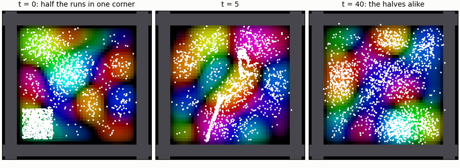

# pilot-wave

A simulated version of physical experiments that can act as a testbed
to understand where various models break down and why. The
experiments are fixed: a source, some walls, a detector, and what the
detector should record. The models are swappable engines, each a way
of moving a particle through the same setup, and each is judged only
by what lands on the detector. It is written from scratch in Rust
with no dependencies.


## Where the models stand

Two engines so far. `quantum` is the de Broglie-Bohm pilot wave: a
wavefunction stepped by the Schrödinger equation, and particles that
ride its probability current. `classical` is Newton's particles and
no wave.

| experiment | quantum | classical |
|---|---|---|
| free | pass | pass |
| mirror | pass | pass |
| barrier | pass | fails |
| relaxation | pass | pass |
| single-slit | pass | fails |
| double-slit | pass | fails |

Where the classical engine breaks, and why:

- **Barrier.** A particle either has the energy to climb the barrier
  or it turns back. Only the fastest 0.8% of the beam has it, where
  23% should get through.
- **Slits.** A particle that goes through an opening goes straight
  on, so the screen shows the shadow of the wall: no side lobes
  behind one slit, no fringes behind two. Nothing tells a particle in
  one slit that the other is open.

## An experiment

An experiment (`src/experiment.rs`) is plain data and names no
engine:

- **the stage**: the size of the plane, hard walls as rectangles, and
  a potential V(x, y);
- **the source**: a particle's position, velocity and the width of
  the beam it comes in, or a starting wave written out as a function
  of position;
- **the runs**: how many times the one-particle run is repeated, each
  from its own starting position, and for how long;
- **the detector**: a line that records where and when each particle
  first crosses it, and optionally the closed form to compare with;
- **the expectations**: a measure, an expected value and a tolerance.

The measures are only what a detector could record: how many
particles arrive, where, when, and where they all are at the end. No
measure looks at a wave, so an engine without one is judged the same
way. Expected values are the closed form's, never corrected for a
solver's grid; where a grid costs half a percent, the tolerance says
so.

## An engine

An engine (`src/engine.rs`) is four things: the time its step takes,
the step, where every run's particle is, and a field to draw if it
has one. It is built from an experiment and the runs' starting
positions. Nothing outside `src/engines/` knows more than that, and a
new engine is a file there and a line in `engine::named`.
`ENGINE.md` says how the two existing ones work.

## The experiments

Each is a file in `src/experiments/`. Lengths are in units of the
beam's wavelength, so the beam's speed is 2π. "Measured" is the
quantum engine unless a column says otherwise.

### Free flight

A beam 2 wide starts at y = −15 and flies up for a time of 4, through
a screen at y = 0. Every particle should cross the screen, the beam
should arrive where and when its speed says, and it should widen as a
beam this narrow does, σ(t) = σ₀ √(1 + t²/4σ₀⁴). No laboratory
reference: a closed form.

| expectation | expected | quantum | classical |
|---|---|---|---|
| mean y at the end, −15 + 4·2π | 10.133 ± 0.25 | 9.996 | 10.130 |
| spread along the motion | 2.236 ± 0.08 | 2.282 | 2.231 |
| spread across the motion | 2.236 ± 0.03 | 2.244 | 2.244 |
| mean arrival time at the screen, 15/2π | 2.387 ± 0.03 | 2.405 | 2.393 |
| share through the screen | 1 ± 0.001 | 0.9999 | 1.0000 |

For the classical engine to spread at all, its runs must differ in
velocity as well as position. It takes that from the source: a beam
this narrow is seen to diverge by ½ over its width.

### Mirror

The same beam meets a hard wall at y = 5. It should come back as if
mirrored in the wall, as wide across as in free flight, with no
particle beyond the wall. No laboratory reference.

| expectation | expected | quantum | classical |
|---|---|---|---|
| mean y at the end, mirrored in the wall | −0.133 ± 0.25 | 0.025 | −0.145 |
| share beyond the wall | 0 ± 0.0001 | 0.0000 | 0.0000 |


### Barrier

A beam 6 wide and 2 long meets a barrier 0.4 thick and 1.2 times its
energy high. The textbook transmission,
T = 1/(1 + V² sinh²(κa)/4E(V − E)) with κ = √(2(V − E)), averaged
over the beam's spread of speeds, is 0.230. No laboratory reference.

| expectation | expected | quantum | classical |
|---|---|---|---|
| share through the barrier | 0.230 ± 0.02 | 0.215 | **0.008** |

### Relaxation

A box 4 wide holds a wave of its first sixteen modes, sloshing about.
Every other run starts in one corner instead of at the source. At the
end the runs from the corner should be spread as the runs from the
source are: where a run started is forgotten, so the statistics need
not be put in at the start. After Valentini and Westman (2005); no
laboratory reference.

| expectation | expected | quantum | classical |
|---|---|---|---|
| share of the corner's runs misplaced at the end | 0 ± 0.1 | 0.065 | 0.054 |

This one does not tell the engines apart: classical particles
bouncing about a box forget the corner too.



### Single slit

A beam 6 wide and 2 long meets a wall with one slit 2 wavelengths
wide; a screen 30 beyond it counts what comes through. The arrivals
should follow the Fraunhofer pattern sinc²(πa sinθ) cos²θ, its first
zeros at x = ±17.2. Reference: 600 eV electrons, as in Bach et al.
(2013); their slit was over a thousand wavelengths wide, so their
pattern sits at angles a thousand times smaller, with the same shape.

| expectation | expected | quantum | classical |
|---|---|---|---|
| share through the screen | 0.133 ± 0.010 | 0.127 | 0.132 |
| rms gap between the arrivals and Fraunhofer, of the peak | 0 ± 0.04 | 0.028 | **0.116** |
| arrivals at the first zero, of the peak | 0 ± 0.03 | 0.011 | 0.000 |


### Double slit

The same beam meets a wall with two slits 1 wide and 4 apart. The
arrivals should show the fringes cos²(πd sinθ) under the envelope
sinc²(πa sinθ): maxima at x = 0, ±7.7 and ±17, next to nothing
between them. Reference: Bach et al. (2013), slits 62 nm wide and
272 nm apart, d/a = 4.4 against 4 here.

| expectation | expected | quantum | classical |
|---|---|---|---|
| share through the screen | 0.126 ± 0.010 | 0.118 | 0.123 |
| rms gap between the arrivals and Fraunhofer, of the peak | 0 ± 0.05 | 0.038 | **0.132** |
| x of the first-order maximum | 7.7 ± 0.8 | 7.6 | **10.8** |
| arrivals at the first minimum, of the peak | 0 ± 0.1 | 0.025 | 0.012 |

The classical engine passes the expectations at the minima for the
wrong reason: nothing lands there because nothing lands outside the
slits' shadows at all. The gap to Fraunhofer is what catches it.

## What the testbed has shown so far

- Only the slits rest on a laboratory experiment. The barrier is the
  one other setup that separates the engines, and it is a textbook
  formula.
- The quantum engine's particles spread 2.5% more along their motion
  than its wave does, 2.282 against 2.226. A step four times finer
  removes it, so it is the step's doing, not the grid's: the wave's
  real and imaginary parts are half a step apart where the guiding
  velocity reads them.
- Its wave is 0.5% slow at ten cells per wavelength, which is where
  the free flight's 9.996 against 10.133 comes from.

## Running it

```
cargo run --release -- list
cargo run --release -- describe double-slit
cargo run --release -- run double-slit [runs] [out] [--engine=classical]
cargo test --release
```

`run` prints the setup, runs it, prints a verdict per expectation and
exits non-zero if any fails. The engine is `quantum` unless given.
Into `out` it writes a frame every half time unit, the trails of 300
particles, the screen as a plot and a table, the arrivals in order
and where every run started and ended. The double slit needs its
full 60000 runs: with 20000 its pattern is too noisy to pass.

Units are ħ = m = 1. Each experiment names its particle's mass and
the SI length of one unit, and `describe` prints what a unit of
length, time, speed and energy is: for the slits' 600 eV electron,
50 pm, 2.16·10⁻¹⁷ s, 2.3·10⁶ m/s and 30.5 eV.

## Set aside, in the history

Spin without a magnetic field (Das and Dürr 2019) was an experiment
here until it was removed for want of a laboratory behind it; it
lives at commit `eb58db0`. Two particles on a line, with the plane
as their configuration space, were experiments before that:
exclusion, a pair scattered into two branches, an EPR pair. They
live at commit `8b8de50`.
