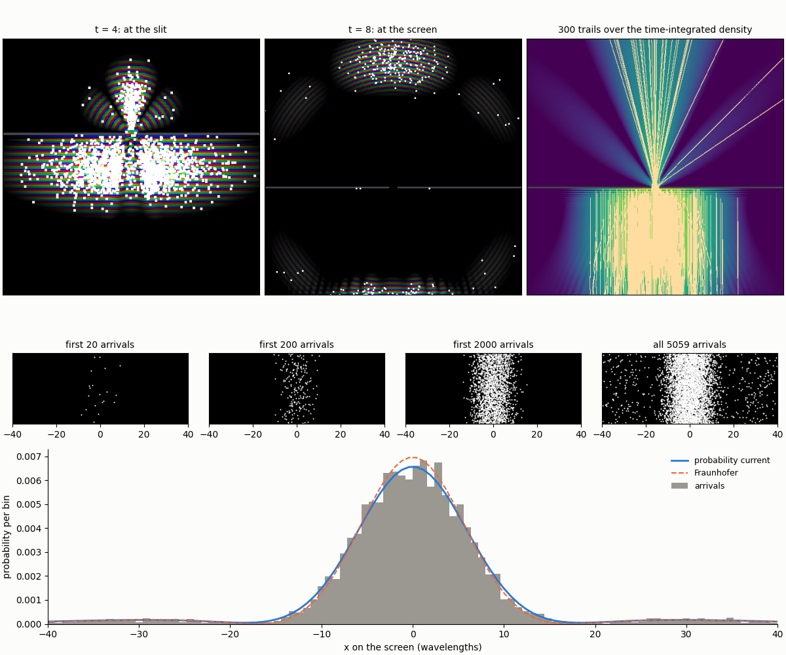
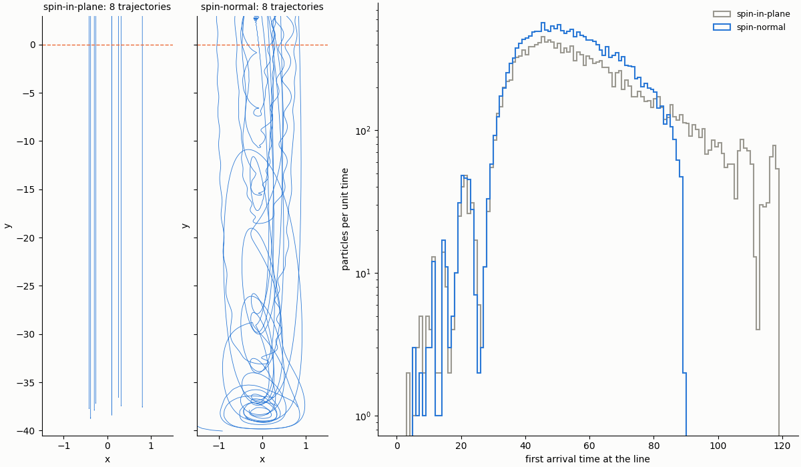

# pilot-wave

A deterministic pilot-wave (de Broglie-Bohm) simulation in two
dimensions, written from scratch in Rust with no dependencies. A
wavefunction on a square grid is stepped by the Schrödinger equation,
and particles with definite positions ride its phase gradient.
Positions drawn from |ψ|² at the start stay distributed as |ψ|², so an
ensemble of deterministic trajectories reproduces the quantum
statistics. Experiments are plain data: a stage, a source, a duration
and a list of expectations, each a named measure with an expected
value and a tolerance, checked after every run. See `GOAL.md` for
what this is working towards.



## Running it

```
cargo run --release -- list
cargo run --release -- describe single-slit
cargo run --release -- run single-slit [particles] [out]
cargo test --release
```

`describe` prints the experiment's summary, its physical realisation
with the unit conversions, the grid, and the expectations. `run`
prints the same, runs, and ends with a verdict per expectation; it
exits non-zero if any fails. It also writes frames
`<out>/<experiment>_NNNN.png` every half time unit (hue is the phase,
brightness the density), the trails of 300 particles over the
time-integrated density, the screen as a plot and a table, and the
arrivals in order. The figures come from

```
cargo run --release -- run single-slit 40000 out/single-slit
.venv/bin/python tools/figures.py single-slit
```

with a Python venv holding numpy and matplotlib at `.venv`.

## Units

The engine uses ħ = m = 1. A beam's wavelength is 1, so its
wavenumber and speed are both 2π and its kinetic energy 2π². Each
experiment names a physical realisation, a particle and the SI length
of one unit, for a beam its de Broglie wavelength λ, and the units
follow: time mλ²/ħ, speed ħ/(mλ), energy ħ²/(mλ²). For a 600 eV
electron (λ = 50 pm) one unit of length is 50 pm, of time
2.16·10⁻¹⁷ s, of speed 2.3·10⁶ m/s and of energy 30.5 eV; `describe`
prints these for every experiment.

## The model

Each step applies the Hamiltonian, a fourth order Laplacian plus the
potential, to the imaginary part to advance the real part, then the
reverse, in one fused sweep per band of rows on all cores
(`wave.rs`). Hard walls are cells kept at zero and an absorbing sponge
at the edges swallows what reaches it. The guiding velocity is the
probability current over the density, each interpolated between the
surrounding cells before dividing, with fourth order gradients, and
particles move in substeps of at most a quarter cell, so they turn
back from the near-nodes of standing waves instead of crossing them
(`particles.rs`). Positions are drawn from |ψ|² on the grid
(`sample.rs`). A screen bins each particle's first crossing of the
line and the time-integrated current through it (`screen.rs`).

A spin direction on the field adds Holland's term ∇×(ρ ŝ)/2ρ to the
guiding velocity, the de Broglie-Bohm velocity of the Pauli equation;
it has no divergence, so the density evolves as without it.

An experiment (`experiment.rs`) is a `Realisation`, a grid, walls as
rectangles (with `slits` and `band` to build them), a potential and a
source as plain functions of position and of the field, a spin, a
particle count, a duration, an optional screen with the closed form
to compare its current with, and expectations: named measures, each
with an expected value and a tolerance. The runner (`run.rs`) builds
the field, samples the particles, steps both, and measures;
`report.rs` prints and writes. `ENGINE.md` describes the engine in
detail: the scheme, the decisions behind it, and which knobs an
experiment turns against which are fixed in the code.

## Experiments

Nine experiments, each a file in `src/experiments/`. The first five
are sanity checks against closed forms, the slits and the spin
experiment against published work. Every expectation is listed by
`describe`, measured by `run`, and the tables below give the measured
values.

### Sanity checks

`free`: a packet 2 wide starts at y = −15 and heads up at speed 2π for
a time of 4, crossing a screen at y = 0. The particles move with it,
all cross the screen, and the ensemble spreads like |ψ|² does,
σ(t) = σ₀ √(1 + t²/4σ₀⁴), each particle keeping its place in the
packet as the trails fan out in straight lines. The grid has its own
dispersion, which the expectations along the motion allow for: at
ten cells per wavelength a wave moves 0.5% slower than k and spreads
as if 2.5% heavier (`group_velocity` and `effective_mass` in
`wave.rs`). The field follows those closed forms to four digits; the
particles' spread along the motion runs 2.5% above the field's at
this resolution and matches it at twenty cells per wavelength.

`mirror`: the same packet meets a hard wall at y = 5 and comes back,
its mean y the mirror image of the free flight's, nothing lost, no
particle beyond the wall.

`ground` and `coherent`: a harmonic trap V = ω²r²/2 with ω = 0.5. In
the ground state, a Gaussian 1 wide, nothing moves: a stationary
state has a real wavefunction up to a phase, so its phase gradient is
zero and every particle stands still for a whole period. The same
Gaussian displaced to x = 4 is a coherent state, which swings through
the trap without changing shape; its phase is linear in position, so
every particle moves with the centre and after half a period each one
has moved exactly 8.

`barrier`: a packet 6 wide across and 2 long meets a barrier 0.4 wide
and 1.2 times its energy high across the whole plane, the textbook
one-dimensional problem: T = 1/(1 + V² sinh²(κa)/4E(V − E)) with
κ = √(2(V − E)), 0.227 at k = 2π and 0.230 averaged over the packet's
spread of wavenumbers. On the grid it comes out a few percent less.
Which particles tunnel is decided by where they start: trajectories
in one dimension cannot cross, so the ones that get through are
exactly the ones that started at the front of the packet.

```
for e in free mirror ground coherent barrier; do
  cargo run --release -- run $e 20000 out/$e
done
.venv/bin/python tools/figures.py sanity
```


| expectation | expected | measured |
|---|---|---|
| free: mean y at the end, −15 + 4·2π at the grid's speed | 10.008 ± 0.05 | 9.996 |
| free: spread of the particles across the motion | 2.236 ± 0.03 | 2.244 |
| free: spread of the field across the motion | 2.236 ± 0.01 | 2.2363 |
| free: spread of the particles along the motion, with the grid's mass | 2.225 ± 0.08 | 2.281 |
| free: spread of the field along the motion, likewise | 2.225 ± 0.03 | 2.2257 |
| free: mean arrival time at the screen | 2.399 ± 0.02 | 2.405 |
| free: fraction through the screen, probability left | 1 ± 0.001 | 0.9999, 1.0003 |
| mirror: mean y at the end, mirrored in the wall | −0.008 ± 0.1 | 0.026 |
| mirror: fraction beyond the wall, probability left | 0 ± 0.0001, 1 ± 0.005 | 0.0000, 1.0009 |
| ground: median distance moved over a period | 0 ± 0.001 | 0.0000 |
| ground: spread along x, the ground state's width | 1 ± 0.02 | 1.003 |
| coherent: mean x after half a period | −4 ± 0.05 | −3.993 |
| coherent: median distance moved, twice the swing | 8 ± 0.05 | 7.9998 |
| barrier: fraction of particles through, averaged textbook T | 0.230 ± 0.02 | 0.215 |
| barrier: probability through, likewise | 0.230 ± 0.02 | 0.220 |
| barrier: fraction of the transmitted that started in the front | 1 ± 0.01 | 1.000 |

### Single slit

A packet 6 wide across and 2 long heads up at speed 2π towards a wall
0.4 thick with one slit 2 wavelengths wide; a screen 30 further on
counts what comes through. Every particle is an independent run of the
one-particle experiment, since all share the field and never interact,
so one run with 40000 particles is 40000 runs with one, and the
arrivals are recorded in order so the pattern can be watched building
up one particle at a time, as in the electron build-up films.

Realisation: a 600 eV electron, as in Bach et al. (2013), whose slit
was 62 nm, over a thousand wavelengths, so their pattern sits at angles
a thousand times smaller than ours; the shape, sinc² with a cos²
obliquity factor, is the same.

| expectation | expected | measured |
|---|---|---|
| fraction through the screen, the beam's share across the slit | 0.133 ± 0.010 | 0.1264 |
| probability through the screen, likewise | 0.133 ± 0.010 | 0.1271 |
| rms gap between the current and Fraunhofer, of the peak | 0 ± 0.03 | 0.0177 |
| rms gap between the arrivals and the current, of the peak | 0 ± 0.03 | 0.0257 |
| current at the first zero of sinc², x = 17.2, of the peak | 0 ± 0.02 | 0.0095 |

The arrived fraction sits 5% under the geometric share because the
slit's edges diffract some of the wave back; the current's first
minimum falls to 1% of the peak at the predicted place.

### Double slit

The same beam meets a wall with two slits 1 wide and 4 apart, centre
to centre: cos²(πd sinθ) fringes under the sinc²(πa sinθ) envelope,
orders at sinθ = m/4. Each particle goes through one slit or the
other and never crosses the axis of symmetry, yet the ensemble lands
on the fringes, which build up one particle at a time as in the
electron films. The realisation is again the 600 eV electron of Bach
et al. (2013), whose slits were 62 nm wide and 272 nm apart: d/a = 4.4
against our 4, so about as many fringes fit under the envelope, but
theirs are 0.18 mrad apart against our 0.25 rad.


| expectation | expected | measured |
|---|---|---|
| fraction through the screen, the beam's share across both slits | 0.126 ± 0.010 | 0.1184 |
| probability through the screen, likewise | 0.126 ± 0.010 | 0.1195 |
| rms gap between the current and Fraunhofer, of the peak | 0 ± 0.035 | 0.0282 |
| rms gap between the arrivals and the current, of the peak | 0 ± 0.03 | 0.0225 |
| x of the first-order maximum, d sinθ = 1 | 7.7 ± 0.8 | 7.6 |
| current at the first minimum, d sinθ = 1/2, of the peak | 0 ± 0.1 | 0.019 |
| fraction of the particles that ever crossed the axis of symmetry | 0 ± 0.0001 | 0.0000 |

## Spin without a magnetic field

In the de Broglie-Bohm theory of the Pauli equation the spin is a
property of the pilot wave, a spinor, and the velocity carries one
more term than the spinless one: v = Im(ψ†∇ψ)/ψ†ψ + ∇×(ψ†σψ)/2ψ†ψ
(Holland 1993). For a spin eigenstate ψ†σψ = ρ ŝ with ŝ the spin
direction, so the term is ∇×(ρ ŝ)/2ρ; it has no divergence, so |ψ|²
evolves exactly as without it and every position statistic is
unchanged, yet the trajectories differ. For a particle moving in the
plane only the component of ŝ normal to the plane matters, giving
(∂ᵧρ, −∂ₓρ)/2ρ. Das and Dürr (2019, Sci. Rep. 9, 2242) showed that
this makes the arrival times of a spin-1/2 particle released from a
box into a waveguide depend on its spin, with no magnetic field
anywhere: with the spin across the guide the arrivals stop after a
maximum time, where the spinless distribution has a long tail. (Which
arrival-time distribution a real detector records is contested; see
Goldstein, Tumulka and Zanghì 2024 and the reply by Das et al.)

`spin-in-plane` and `spin-normal` are the plane version: a particle
in the ground state of a box 4 long at the closed end of a channel
along y, confined across it by ½ω²x² with ω = 4 (|ψ|² 0.35 wide), is
released at t = 0, and a line 40 further on records when each
particle first crosses it. With the spin in the plane the
trajectories are the spinless ones. With the spin normal to the plane
the term is a circulation along the contours of the density, and the
particles loop as they go: up the channel on one side of the axis and
down on the other, by ωx, and across it where the density changes
along the channel, so the slow tail behind the front is carried to
the fast side and the arrivals pinch off. The sponge beyond the line
takes the wave away, but the slow tail's long wavelengths partly
reflect from it, so the line sits 49 before the sponge; with it 6
before, a third fewer particles arrived.

```
cargo run --release -- run spin-in-plane 20000 out/spin-in-plane
cargo run --release -- run spin-normal 20000 out/spin-normal
.venv/bin/python tools/figures.py spin
```



| expectation | spin-in-plane | spin-normal |
|---|---|---|
| fraction of the particles arriving by t = 120 | 0.90 ± 0.01: 0.903 | 1 ± 0.01: 0.9993 |
| fraction arriving after t = 90 | 0.10 ± 0.01: 0.098 | 0 ± 0.01: 0.0000 |
| mean arrival time | 60.5 ± 1: 60.5 | 55 ± 1: 55.0 |

The realisation is the electron of Das and Dürr with a box 50 μm long,
one unit 12.5 μm, so the line is 0.5 mm down the guide and the unit
of time is 1.35 μs; the units `describe` prints. Their guide is a
cylinder and ours a strip, so the numbers differ, but the mechanism
and the pinch-off are the same.

## Set aside, in the history

Two particles on a line, with the plane as their configuration space,
were done here as experiments before being set aside to keep the set
small: fermions, bosons and distinguishable particles meeting,
Pauli exclusion from the node alone; a pair scattered into two
branches, entangled by meeting, each particle's side telling the
other's; a molecule bouncing off a wall only one particle feels; and
an EPR pair flying apart, its correlation surviving separation, with
a wall on one particle moving the other without any observable sign
of it. They live at commit `8b8de50` with their figures and README
sections, and the engine needs nothing new to run them again.

Worth setting up next: the Kocsis et al. (2011) weak-measurement
trajectories against the double slit's, the Aharonov-Bohm flux line
done earlier as a sign-flipping cut, and the Arago spot behind a disc.
