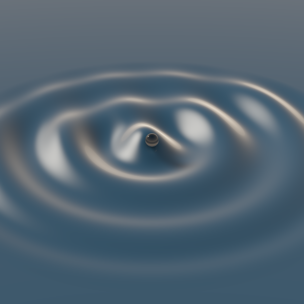
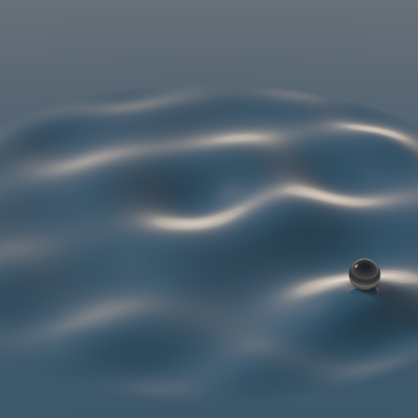
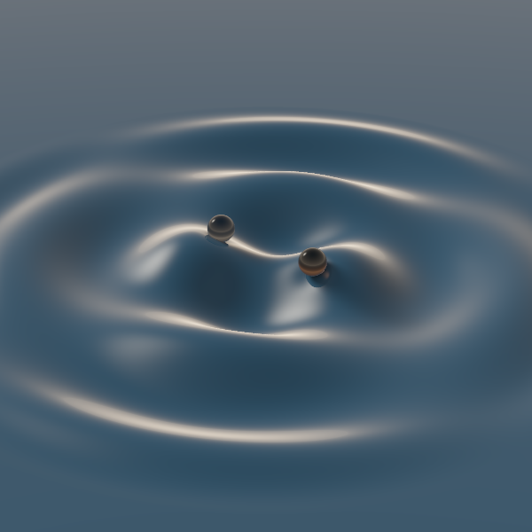
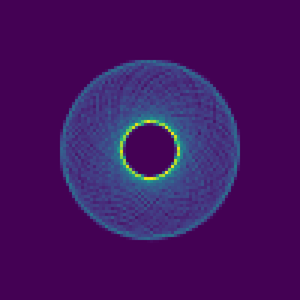
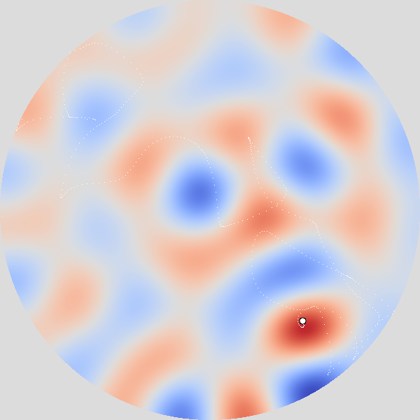
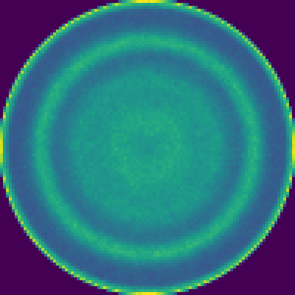

# pilot-wave

A small Rust simulation of walking droplets (pilot-wave hydrodynamics),
written from scratch with a live viewer built on eframe (egui). It is a
stroboscopic path-memory model: every bounce leaves a decaying standing
wave at the Faraday wavelength, the droplet slides down the slope of the
sum of all past waves, and a memory parameter sets how long the bath
remembers. Physical accuracy is not the goal; the qualitative
quantum-like behaviour is. The Python prototype it grew from lives in
[prototype/](prototype/README.md).



## Running it

```
cargo run --release -- <scene> [memory] [bounces] [every] [out] [view]
```

- `scene` is `single`, `pair`, `trap` or `corral`.
- `memory` is how many bounces a wave lasts, default 20.
- `bounces` is how long to run, default 1200; `every` writes a frame
  every so many bounces, default once at the end.
- `out` is the output directory, default `out`.
- `view` is `top` (default) or `oblique`.

Every run writes `<out>/<scene>_NNNNN.png` frames and a position
histogram `<out>/<scene>_histogram.png` of the first droplet, skipping
the first 5000 bounces. For a video, write a frame every few bounces
and hand the sequence to ffmpeg:

```
cargo run --release -- pair 8 2400 4 out oblique
ffmpeg -framerate 30 -i out/pair_%05d.png pair.mp4
```

Tests run with `cargo test --release`.

## Live viewer

```
cargo run --release --bin live
```

The side panel picks the scene, the memory (logarithmic, 1 to 400),
how many bounces to run per frame and the top or oblique view, with
pause and reset buttons and a readout of the bounce count and frame
rate. Changing the scene or memory starts over. The bath is sampled
coarser than the command line renders, on all cores, to keep it fluid;
long memories still slow it down since every remembered bounce adds a
wave to evaluate.


## The model

Lengths are in Faraday wavelengths and time is in bounces. In the
unbounded bath (`field.rs`) the wave left by an impact at `x_n` is
`J0(k |x - x_n|)` with `k = 2π`, decaying by `exp(-1/memory)` per
bounce. Each bounce the droplet feels the slope of the summed field,
loses a fixed fraction of its momentum and steps by its velocity
(`walker.rs`). `bessel.rs` holds J0 and J1 so there is no SciPy
equivalent to depend on.

The bouncer at rest sits on top of its own wave hill. The hill grows
with memory, and once `k² · FORCE · memory² > 2 · DRAG` (memory about
5 for the constants in the file) the slightest noise tips the droplet
over and it walks at a steady 0.04 wavelengths per bounce.

The corral (`corral.rs`) is a disc with a reflecting rim. Instead of
images, the bath's memory lives in the disc's standing modes near the
Faraday wavenumber (`modes.rs`): an impact adds to each mode in
proportion to the mode's value there, through a Gaussian window on
the wavenumber, and the modes decay with memory. The rim is thereby
built into the waves themselves. The droplet bounces off the rim.

## Views

`topdown.rs` paints the field through matplotlib's coolwarm colormap
with droplets and trails on top. `oblique.rs` renders the field as a
lit liquid surface: rays are marched to the heightfield and shaded
with a key light, a soft fill and a Fresnel reflection of a gradient
sky. The droplets (`oblique/droplet.rs`) are beads of silicone oil
resting on the bath: light refracts through them, so they show the
scene behind them upside down, dark on top with the bright horizon
at the bottom; they reflect in the surface beneath them, sink into a
small dimple, darken the contact zone and cast a soft shadow. Stills
use four rays per pixel, the live view one. Colormaps are tables
sampled from matplotlib by `tools/colormaps.py`.



## What to look for

**Pairs.** Two droplets started 0.7 wavelengths apart with a small
tangential nudge lock into orbit at a separation of 0.73 wavelengths
at memory 8. Started 1.6 apart they orbit at 1.69. Experiments find
orbit diameters near `(n - 0.2)` wavelengths. At memory 20 and above
the orbits break up and the droplets scatter, as in experiments.



**Trap.** The `trap` scene adds a spring force towards the origin. At
memory 20 the droplet settles on a precessing orbit whose radius is
set by the wave field, a sharp annulus in the histogram. At memory 50
and above the motion turns chaotic and the position histogram is a
featureless blob: the quantization is in the orbits, not in the
position density.



**Corral.** The `corral` scene is the hydrodynamic version of the
quantum corral of Crommie, Lutz and Eigler, where electrons fenced in
by a ring of iron atoms show a Bessel-mode density, and of the
walking-droplet corral of Harris et al. (2013). At memory 20 the
droplet hugs the rim. At memory 100 it fills the disc evenly. From
memory 200 on, the long-time position histogram develops a central
spot and concentric rings, even though every single stretch of the
trajectory is chaotic. The image below is memory 400 over ten
million bounces, which takes about a minute:

```
cargo run --release -- corral 400 10000000 10000000 out
```



