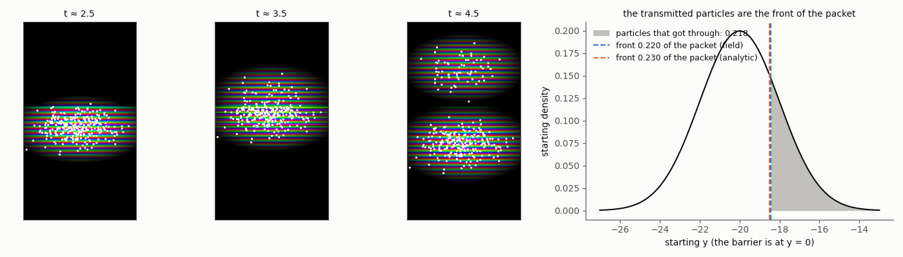
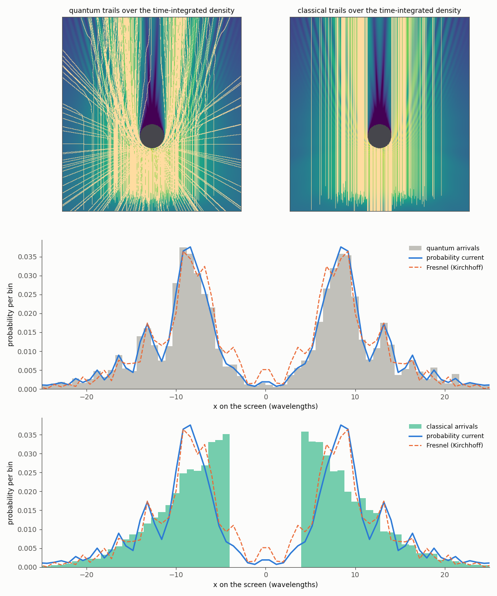
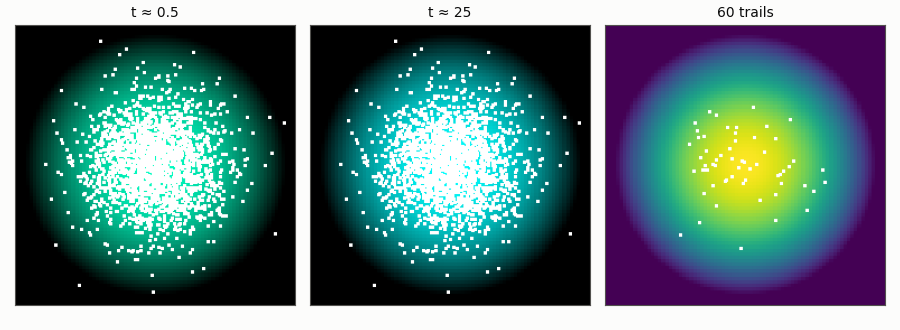
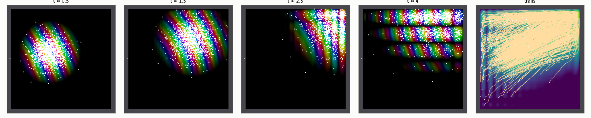

# pilot-wave

A de Broglie-Bohm pilot-wave simulation in two dimensions, written from
scratch in Rust. A wavefunction on a square grid is stepped by the
Schrödinger equation (units ħ = m = 1, wavelength 1, so the packet's
wavenumber and speed are both 2π), and particles with definite
positions ride its phase gradient. Positions drawn from |ψ|² at the
start stay distributed as |ψ|², so an ensemble of deterministic
trajectories reproduces the quantum statistics. In classical mode the
same particles obey Newton in the same potential instead, for
comparison. The only dependency is eframe, for the live viewer.


## Running it

```
cargo run --release -- <experiment> [particles] [out] [classical]
```

`experiment` is `free`, `double-slit`, `single-slit`, `barrier`, `disc`,
`harmonic`, `ground` or `box`; `particles` defaults to 2000 and `out` to
`out`. A run writes frames `<out>/<experiment>_NNNN.png` every half time
unit (hue is the phase, brightness the density), the trails of 300
particles over the time-integrated density in
`<out>/<experiment>_trajectories.png`, and its checks on stdout. The
experiments with a screen also write `<out>/<experiment>_screen.png`
and `.csv`: the particle arrivals (white), the time-integrated
probability current through the screen (blue) and the theory (orange),
arrivals and theory scaled to the current's total.

The figures below are made from runs into `out/<experiment>` (and
`out/<experiment>-classical`, `out/harmonic-few` with 12 particles,
`out/ground-few` with 60 and `out/barrier-few` with 300), each run's
stdout saved as `summary.txt` beside it:

```
mkdir -p out/double-slit
cargo run --release -- double-slit 60000 out/double-slit | tee out/double-slit/summary.txt
.venv/bin/python tools/figures.py
```

## Experiments

All runs share a 1024² grid of cells 0.1 wide (a domain 102.4 across,
ten cells per wavelength) with an absorbing sponge at the edges; the
traps and the box use a 256² grid of the same cells. The packet starts
at y = −20 heading up at speed 2π, walls sit at y = 0 and the screen at
y = 30. A run with a screen lasts until the packet's centre would be 25
past the screen, which lets 99.7% of the transmitted wave through it;
stopping as soon as the centre arrived missed a tenth of it. Every
screen run reports the fraction of particles that crossed the screen
against the probability that crossed it, which Bohmian mechanics says
agree.

### Double slit

Two slits 1 wide with centres 4 apart, in a wall 0.4 thick, lit by a
packet 6 wide (standard deviation of |ψ|² across) and 2 long. The
Fraunhofer curve is the two-slit cos² fringes under the single-slit
sinc² envelope, times cos²θ for a cylindrical wave meeting a flat
screen; with d/a = 4 there are orders at sin θ = m/4, at x = 0, ±7.7,
±17.2 and ±33.8.

With 60000 particles, 7066 (0.1178) reach the screen against 0.1195 of
the probability, and the rest reflect. The current follows the
Fraunhofer curve to 2.8% of the peak, rms, with its maxima at 0, ±7.6,
±16.4 and ±30.8 where the curve's are (the envelope pulls them in from
the grating angles). Summed over each order the current is within 10%
of the curve's in orders 0 to 2 and 28% above it in the faint third.
The arrivals match the current to 1.5% in every order up to the
second and to 7% in the faint third, 2.1% of the peak rms over the
whole screen; no single bin is off by more than 6%. Of 20000 classical
particles, 2545 (0.127, the beam's share over the two slits is 0.126)
arrive, every one within |x| < 3.

The figure at the top shows the quantum trails over the time-integrated
density, the classical trails, and the screens. The quantum arrivals
land on the fringes, fringe for fringe; the trails bend into the
bright fringes in the first few wavelengths past the wall and never
cross the axis of symmetry. The classical particles, all launched
straight up, go through the slits in straight lines and make two bands
the width of the slits at x = ±2, with nothing between or beyond.
Most particles of both kinds bounce off the wall.

Real electron double slits show the same pattern at much smaller
angles. Bach et al. (2013) used 600 eV electrons, wavelength 50 pm,
slits 62 nm wide and 272 nm apart: d/a = 4.4 against our 4, so the
envelope holds about the same number of fringes, but the fringes are
λ/d = 0.18 mrad apart against our 0.25 rad, because their slits are
over a thousand wavelengths wide where ours are one. Jönsson's first
electron double slit (1961) used 50 kV electrons, λ ≈ 5 pm, and slits
quoted as about 0.3 µm wide and 1 µm apart, fringes some 5 µrad apart.
The physics is the same cos² fringes under a sinc² envelope; ours are
simply spread over large angles because the slits are a few
wavelengths across, which is also why the cos²θ obliquity matters here
and not there.

### Single slit

One slit 2 wide, the same beam and screen. The envelope sinc²(πa sinθ)
has its first zeros at sin θ = λ/a = 1/2, x = ±17.2 on the screen,
dotted in the figure, and side lobes near x = ±30.


With 40000 particles, 5097 (0.1274) reach the screen against 0.1271
of the probability. The current follows the Fraunhofer curve to 1.8% of
the peak, rms over the screen, with its minimum at x = 18.0 against
17.2 (one bin of 0.8) where it falls to 0.7% of the peak, and side
lobes within 4% of the curve's. The arrivals match the central lobe to
0.3% and the side lobes to 4%.

### Barrier

A potential step 0.4 wide (four cells) and 1.2 times the packet's
energy high across the whole domain at y = 0, with a packet 4 wide and
2 long. The rectangular-barrier transmission at k = 2π is
T = 1/(1 + V² sinh²(κa) / (4E(V − E))) with κ = √(2(V − E)); averaged
over the packet's Gaussian spread of wavenumber, standard deviation
1/(2σ_y) = 0.25, it rises slightly because the faster part tunnels more
easily.



The analytic transmission is 0.2268 at k = 2π and 0.2301 averaged
over the packet. The field agrees: 0.2199 of the probability crosses
the screen, 4% below the average, the grid's slightly heavier
effective mass along the motion accounting for most of the gap. The
particles agree with the field: 873 of 4000, 0.2182, get through.

The figure shows the packet splitting and, on the right, where the
transmitted particles started. In one dimension Bohmian trajectories
cannot cross, and this barrier is uniform in x, so the particles that
get through are exactly the ones that started at the front of the
packet. Which particle tunnels is decided by where it starts, not by
any chance at the barrier: every transmitted particle started at
y ≥ −18.432 and every reflected one at y ≤ −18.435, and the field's
transmission puts the split at −18.46. Getting this right needed the
velocity estimate described under Numerics: in front of the barrier
the incident and reflected waves (|r| = 0.88) make a standing wave
whose near-nodes are a fifth of a cell wide, and a velocity
interpolated between cells let particles cross them, 0.389 of them
getting through.

### Disc

A hard disc of radius 4 in a beam 8 wide. In two dimensions the disc
is a strip in cross-section, so its Poisson-Arago spot is a line along
the axis behind it. The orange curve is the Fresnel (Kirchhoff)
diffraction of the Gaussian beam with the disc's diameter blocked,
carried paraxially to the screen; the Fresnel number there is
R²/(λL) = 0.53, so the shadow is partly filled.



The field shows the spot: behind the disc the time-integrated density
has a dark wedge with a faint bright line down its middle, and on the
screen the current on the axis is 2.7 times that 1.2 to either side
(Kirchhoff predicts 3.3 times). The current follows the Fresnel curve
to 5% of the peak, rms, edge fringes in the lit region included;
Kirchhoff puts 7.9% of the screen's probability inside the geometric
shadow |x| < 4 where the field puts 4.0%, which is about what to expect
of Kirchhoff's boundary conditions on an obstacle only eight
wavelengths across.

Quantum particles fill the shadow as the current does: 13095 of 20000
(0.6548) reach the screen against 0.6559 of the probability, 3.9% of
the arrivals land inside |x| < 4 against 4.0% of the current, and the
four bins around the axis get 86% of the particles the current puts
there. The classical particles cast a sharp shadow: 12222 (0.611; the
Gaussian beam has 0.617 outside |x| < 4) reach the screen, none inside
|x| < 4.

### Harmonic trap and ground state

A trap V = ω²r²/2 with ω = 0.5, period 4π. The coherent state is the
ground-state Gaussian (width 1/√(2ω) = 1) displaced to (4, 0) and given
momentum ω·4 upward, so it orbits on a circle of radius 4 without
changing shape. Its phase is linear in position, so every particle
moves with the packet's centre: each one traces its own circle of
radius 4 around its starting offset from the centre. The figure shows
the packet at quarter periods and twelve trails over two periods.


Over two periods the packet's width stays 1.0000 along both axes.
The worst of 300 trails strays 0.066 from its circle of radius 4, and
after the two periods the particle that ends farthest from its start
is 0.068 away, out of an orbit 50 long: a lag of 0.14%.

The ground state has a real wavefunction up to a global phase, so its
phase gradient is zero everywhere: Bohmian particles in a stationary
state sit still, even though the quantum "motion" in the state is
there in the momentum distribution. The figure shows the density at
the start and after two periods and sixty particles that never move.



Over two periods (t = 25, 14000 steps) no particle of 2000 moves more
than 3.3·10⁻⁶, and the density changes by at most 1.1·10⁻⁶ of its
peak.

### Box and free packet

A packet 1 wide launched at (π, π/2) in a box with hard walls at ±6,
with no sponge. It reflects off the right wall and then the top, and
the standing waves near the walls gather the particles into stripes
parallel to them.



The norm ends at 0.9990 after t = 6 with nothing absorbing it. 0.8%
of the particles end beside a wall, where 0.43% of the probability is.

A free packet 1.5 wide crosses the domain and spreads as
σ(t) = σ₀√(1 + (t/2σ₀²)²); each Bohmian particle keeps its place in the
packet, its offset from the centre growing as x(t) = x₀σ(t)/σ₀, so
the trails fan out in straight lines.


After t = 6 the packet is 2.5003 wide across, against 2.5000 expected,
and 2.4621 along its motion. The difference along y is the grid: at
k·dx = 0.63 the fourth-order Laplacian's dispersion has curvature
0.976 instead of 1, an effective mass 2.5% heavier along the motion,
which predicts 2.4613.

### Numerics

The guiding velocity is the probability current over the density,
each interpolated between the four surrounding cells before dividing,
with fourth order differences for the gradient so a plane wave at ten
cells per wavelength comes out within 0.3%. Interpolating a velocity
computed per cell instead, or the phase difference between
neighbouring cells, smooths over the near-nodes of standing waves,
where the density dips to nearly zero within a fraction of a cell and
the velocity must soar to turn the particle back; particles then cross
them, and the barrier's particle transmission came out 0.389 against
the field's 0.220. Particles move in substeps of at most a quarter
cell for the same reason. Where the wave meets a wall ψ is zero and so
is the velocity. What remains is the grid's dispersion: at k·dx = 0.63
the Laplacian's curvature is 0.976 instead of 1, an effective mass
2.5% heavier along the motion, which the free packet and the barrier
both show. Halving the cells would quarter that.

## Live viewer

```
cargo run --release --bin live
```

The side panel picks the experiment, the particle count, quantum or
classical particles, the grid size (256, 512 or 1024), the replay
speed in time units per second, and the view: phase (hue) with
density (brightness), density alone, or the density as a lit surface.
Under the field, experiments with a screen plot the arrivals, the
integrated current and the theory as they build up. `live --screenshot
images/live.png` runs for two seconds, saves the window and quits.


