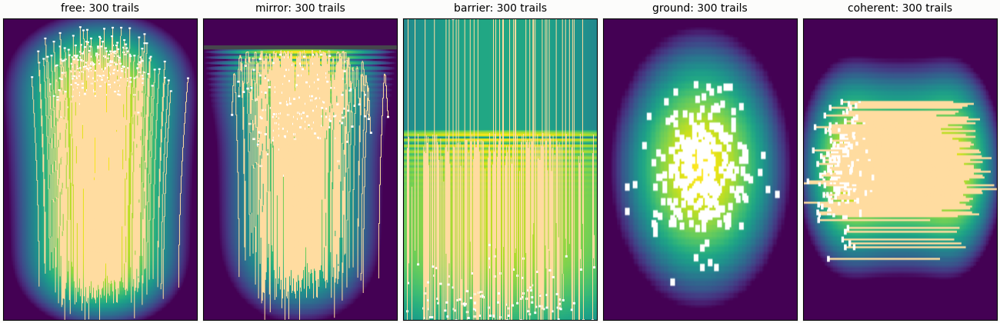

# pilot-wave

Experiments on particles in a plane, and engines that try to
reproduce what their detectors record, written from scratch in Rust
with no dependencies. An experiment is plain data: a stage, a source,
a duration and a list of expectations, each something a detector
could record, with an expected value and a tolerance. An engine is
the physics: it moves each run's particle a step at a time, and
nothing else in the program knows how. There are two. `quantum` is
the de Broglie-Bohm pilot wave, a wavefunction on a square grid
stepped by the Schrödinger equation and particles with definite
positions that ride its probability current. `classical` has no wave
at all. The first meets every expectation; the classical one passes
the free flight and the mirror and fails the barrier and the slits,
as it should. `GOAL.md` says what this is working towards.


## Running it

```
cargo run --release -- list
cargo run --release -- describe single-slit
cargo run --release -- run single-slit [runs] [out]
cargo run --release -- run single-slit [runs] [out] --engine=classical
cargo test --release
```

`describe` prints the experiment's summary and reference, its
particles, the unit conversions, the grid, and the expectations. `run`
prints the same, runs, and ends with a verdict per expectation; it
exits non-zero if any fails. It also writes frames
`<out>/<experiment>_NNNN.png` every half time unit (hue is the phase,
brightness the density), the trails of 300 particles over the
time-integrated density, the screen as a plot and a table, and the
arrivals in order. `--engine=<name>` picks the engine, `quantum`
unless given; `list` names them. The figures come from

```
cargo run --release -- run single-slit 40000 out/single-slit
.venv/bin/python tools/figures.py single-slit
```

with a Python venv holding numpy and matplotlib at `.venv`.

## Units

The engine uses ħ = m = 1. A beam's wavelength is 1, so its
wavenumber and speed are both 2π and its kinetic energy 2π². Each
experiment names its particle's mass and its stage's scale, the SI
length of one unit, for a beam its de Broglie wavelength λ, and the
units follow: time mλ²/ħ, speed ħ/(mλ), energy ħ²/(mλ²). For a 600 eV
electron (λ = 50 pm) one unit of length is 50 pm, of time
2.16·10⁻¹⁷ s, of speed 2.3·10⁶ m/s and of energy 30.5 eV; `describe`
prints these for every experiment.

## Engines

An engine (`engine.rs`) is four things: the time its step takes, the
step, where every run's particle is, and a field to draw if it has
one. It is built from an experiment and the runs' starting positions.
The runner, the detector, the measures and the pictures see only
that; the engines live in `src/engines/`, and a new one is a file
there and a line in `engine::named`.

| experiment | quantum | classical |
|---|---|---|
| free | pass | pass |
| mirror | pass | pass |
| barrier | pass | fails: 0.008 get through, not 0.230 |
| relaxation | pass | pass |
| single-slit | pass | fails: no side lobes, rms gap 0.116 |
| double-slit | pass | fails: no fringes, rms gap 0.132 |

The numbers are in the table under "The engines compared" below.

**quantum.** Each step applies the Hamiltonian, a fourth order
Laplacian plus the potential, to the imaginary part of the
wavefunction to advance the real part, then the reverse, in one fused
sweep per band of rows on all cores (`engines/wave.rs`). Hard walls
are cells kept at zero and an absorbing sponge at the edges swallows
what reaches it. The guiding velocity is the probability current over
the density, each interpolated between the surrounding cells before
dividing, with fourth order gradients, and particles move in substeps
of at most a quarter cell, so they turn back from the near-nodes of
standing waves instead of crossing them (`engines/guided.rs`). Runs
started where |ψ|² is large stay distributed as |ψ|².

**classical.** Newton's particles (`engines/classical.rs`). A run
flies through the potential keeping its energy and bounces off the
walls. The runs of a beam differ in velocity as well as in position:
each has the particle's velocity and a share of the beam's
divergence, ½ over the packet's width, taken as a property of the
source.

## The experiment

An experiment (`experiment.rs`) is a stage, the particles, a run
count, a duration, a detector and expectations, and names no engine.
The stage is the grid, what one unit of length is in metres, the hard
walls as rectangles (with `slits` and `band` to build them) and the
potential V(x, y), a plain function, all fixed before the run. A
particle is a kind (name and mass), a position, a velocity and the
width of the packet that carries it. The wave at the start is that
Gaussian packet, unless the experiment gives a state of its own, a
function of position, as the relaxation does with its box. The run
count says how many times the run is repeated, each from its own
start, drawn from the square of the wave at the start (`sample.rs`),
or for every other run evenly from a rectangle when the experiment
names one; the runs never interact. The detector is a screen height,
binning each particle's first crossing (`screen.rs`), and optionally
the closed form the arrivals are compared with. The runner (`run.rs`)
draws the starts and steps the engine, `measure.rs` answers the
expectations, and `report.rs` prints and writes.

## Experiments

Six experiments, each a file in `src/experiments/`. The first three
are sanity checks against closed forms, the fourth lets the particles'
statistics come about instead of putting them in, and the slits are
checked against published work. Every
expectation is listed by `describe`, measured by `run`, and the tables
below give the measured values.

The wavefunction is never observed; a detector records particles,
their positions, counts and times, and nothing else. So the
experiments expect only such things: where the particles land, how
many, and when, and that is what lets another engine be put to the
same test. The closed form is drawn beside the arrivals in the screen
plots, for the eye.

### Sanity checks

`free`: a packet 2 wide starts at y = −15 and heads up at speed 2π for
a time of 4, crossing a screen at y = 0. The particles move with it,
all cross the screen, and the ensemble spreads as a beam this narrow
must, σ(t) = σ₀ √(1 + t²/4σ₀⁴). The tolerances along the motion are
1% of the flight, which is what a grid of ten cells per wavelength
can hold: there the quantum engine's wave moves 0.5% slower than k.

`mirror`: the same packet meets a hard wall at y = 5 and comes back,
its mean y the mirror image of the free flight's, nothing lost, no
particle beyond the wall.

`barrier`: a packet 6 wide across and 2 long meets a barrier 0.4 wide
and 1.2 times its energy high across the whole plane, the textbook
one-dimensional problem: T = 1/(1 + V² sinh²(κa)/4E(V − E)) with
κ = √(2(V − E)), 0.227 at k = 2π and 0.230 averaged over the packet's
spread of wavenumbers. On the grid it comes out a few percent less
(0.215 of the particles).

```
for e in free mirror barrier; do
  cargo run --release -- run $e 20000 out/$e
done
.venv/bin/python tools/figures.py sanity
```



| expectation | expected | measured |
|---|---|---|
| free: mean y at the end, −15 + 4·2π | 10.133 ± 0.25 | 9.996 |
| free: spread of the particles across the motion | 2.236 ± 0.03 | 2.244 |
| free: spread of the particles along the motion | 2.236 ± 0.08 | 2.282 |
| free: mean arrival time at the screen, 15/2π | 2.387 ± 0.03 | 2.405 |
| free: fraction through the screen | 1 ± 0.001 | 0.9999 |
| mirror: mean y at the end, mirrored in the wall | −0.133 ± 0.25 | 0.025 |
| mirror: fraction beyond the wall | 0 ± 0.0001 | 0.0000 |
| barrier: fraction of particles through, averaged textbook T | 0.230 ± 0.02 | 0.215 |

### Relaxation

`relaxation`: a box 4 wide holds a wave made of its first sixteen
modes in equal measure, each with its own phase, so the density
sloshes about and the nodes of the wave wander through the box.
Every other run is not placed where the source says: ten thousand
start in a square of side 1 in one corner. Each is carried round the
wandering nodes, neighbours are pulled apart, and the ensemble is
stirred through the box. Counted in squares of side 0.5, the share of
the runs from the corner that would have to move to match the runs
from the source ends at 0.065. This is the relaxation Valentini and
Westman (2005) found for sixteen modes of a box. Where particles are
found need not be put in at the start: in a wave busy enough it comes
about, and then stays. One run in five hundred ends in the first cell
of a wall, where the wave is zero and nothing moves it. The
experiment does not tell the engines apart: the classical engine's
runs bounce about the box and forget the corner too, 0.054.

```
cargo run --release -- run relaxation 20000 out/relaxation
.venv/bin/python tools/figures.py relaxation
```


| expectation | expected | measured |
|---|---|---|
| share of the runs from the corner misplaced at t = 40, in squares of side 0.5 | 0 ± 0.1 | 0.065 |

### Single slit

A packet 6 wide across and 2 long heads up at speed 2π towards a wall
0.4 thick with one slit 2 wavelengths wide; a screen 30 further on
counts what comes through. Every particle is an independent run of the
one-particle experiment, since all share the field and never interact,
so one run with 40000 particles is 40000 runs with one, and the
arrivals are recorded in order so the pattern can be watched building
up one particle at a time, as in the electron build-up films.

Reference: a 600 eV electron, as in Bach et al. (2013), whose slit
was 62 nm, over a thousand wavelengths, so their pattern sits at angles
a thousand times smaller than ours; the shape, sinc² with a cos²
obliquity factor, is the same.

| expectation | expected | measured |
|---|---|---|
| fraction through the screen, the beam's share across the slit, erf(1/6√2) | 0.133 ± 0.010 | 0.1265 |
| rms gap between the arrivals and Fraunhofer, of the peak | 0 ± 0.04 | 0.028 |
| arrivals at the first zero of sinc², x = 17.2, of the peak | 0 ± 0.03 | 0.011 |

### Double slit

The same beam meets a wall with two slits 1 wide and 4 apart, centre
to centre: cos²(πd sinθ) fringes under the sinc²(πa sinθ) envelope,
orders at sinθ = m/4. Each particle goes through one slit or the
other and never crosses the axis of symmetry, which no detector could
see without destroying the fringes, so it is shown in the trails and
not expected; the ensemble lands on the fringes, which build up one
particle at a time as in the electron films. The reference is again the 600 eV electron of Bach
et al. (2013), whose slits were 62 nm wide and 272 nm apart: d/a = 4.4
against our 4, so about as many fringes fit under the envelope, but
theirs are 0.18 mrad apart against our 0.25 rad.


| expectation | expected | measured |
|---|---|---|
| fraction through the screen, the beam's share across both slits | 0.126 ± 0.010 | 0.1184 |
| rms gap between the arrivals and Fraunhofer, of the peak | 0 ± 0.05 | 0.038 |
| x of the first-order maximum of the arrivals, d sinθ = 1 | 7.7 ± 0.8 | 7.6 |
| arrivals at the first minimum, d sinθ = 1/2, of the peak | 0 ± 0.1 | 0.025 |

## The engines compared

Every expectation of every experiment, on each engine. What fails is
in bold.

| expectation | expected | quantum | classical |
|---|---|---|---|
| free: mean y at the end | 10.133 ± 0.25 | 9.996 | 10.130 |
| free: spread of the particles along the motion | 2.236 ± 0.08 | 2.282 | 2.231 |
| free: spread of the particles across the motion | 2.236 ± 0.03 | 2.244 | 2.244 |
| free: mean arrival time at the screen | 2.387 ± 0.03 | 2.405 | 2.393 |
| free: fraction through the screen | 1 ± 0.001 | 0.9999 | 1.0000 |
| mirror: mean y at the end | −0.133 ± 0.25 | 0.025 | −0.145 |
| mirror: fraction beyond the wall | 0 ± 0.0001 | 0.0000 | 0.0000 |
| barrier: fraction of particles through | 0.230 ± 0.02 | 0.215 | **0.008** |
| relaxation: share of the corner's runs misplaced at t = 40 | 0 ± 0.1 | 0.065 | 0.054 |
| single slit: fraction through the screen | 0.133 ± 0.010 | 0.127 | 0.132 |
| single slit: rms gap to Fraunhofer | 0 ± 0.04 | 0.028 | **0.116** |
| single slit: arrivals at the first zero | 0 ± 0.03 | 0.011 | 0.000 |
| double slit: fraction through the screen | 0.126 ± 0.010 | 0.118 | 0.123 |
| double slit: rms gap to Fraunhofer | 0 ± 0.05 | 0.038 | **0.132** |
| double slit: x of the first-order maximum | 7.7 ± 0.8 | 7.6 | **10.8** |
| double slit: arrivals at the first minimum | 0 ± 0.1 | 0.025 | 0.012 |

The classical engine's slits pass two expectations they have no
business passing: nothing lands at the single slit's first zero or
between the double slit's shadows because nothing lands outside the
shadows at all. The gap to Fraunhofer is what catches it.

The quantum engine's particles spread 2.5% more along the motion than
its wave does on this grid, 2.282 against 2.226. A step four times
finer brings them to 2.226 too, so that gap is not the grid's: it
comes from the wave's real and imaginary parts being half a step
apart in the guiding velocity.

## Set aside, in the history

Two particles on a line, with the plane as their configuration space,
were done here as experiments before being set aside to keep the set
small: fermions, bosons and distinguishable particles meeting,
Pauli exclusion from the node alone; a pair scattered into two
branches, entangled by meeting, each particle's side telling the
other's; a molecule bouncing off a wall only one particle feels; and
an EPR pair flying apart, its correlation surviving separation, with
a wall on one particle moving the other without any observable sign
of it. They live at commit `8b8de50` with their figures and README
sections.

Worth setting up next: the Kocsis et al. (2011) weak-measurement
trajectories against the double slit's, the Aharonov-Bohm flux line
done earlier as a sign-flipping cut, and the Arago spot behind a disc.
