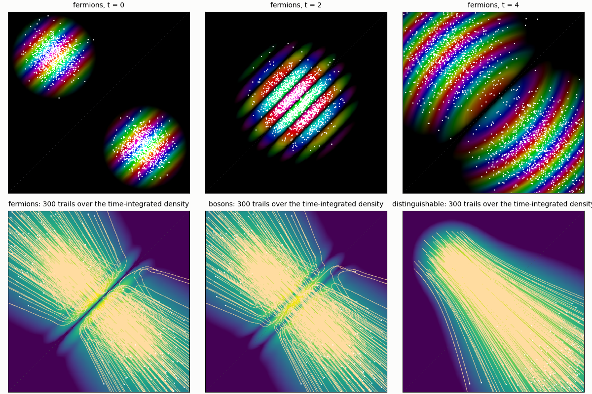
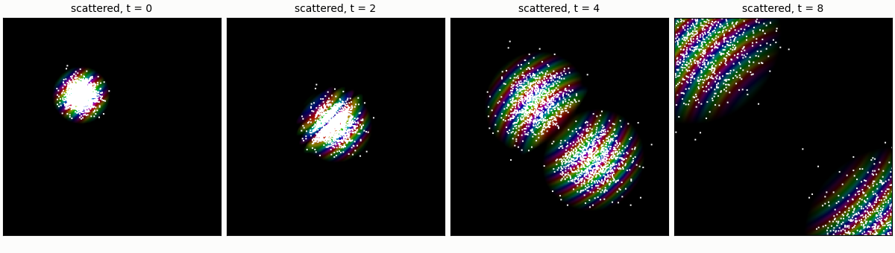
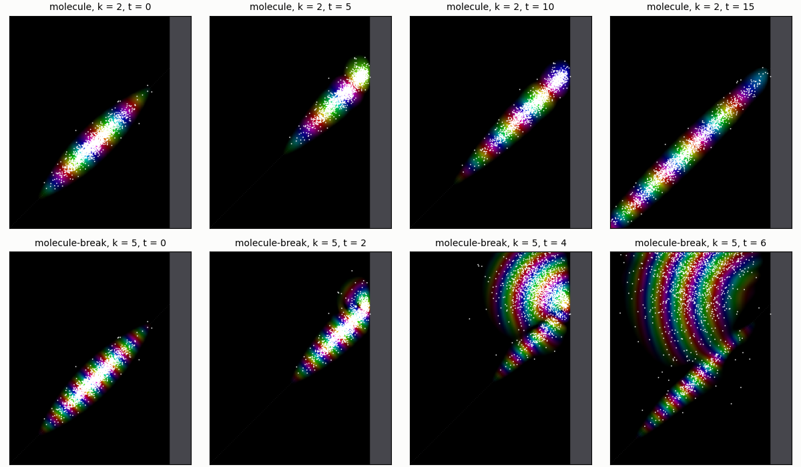
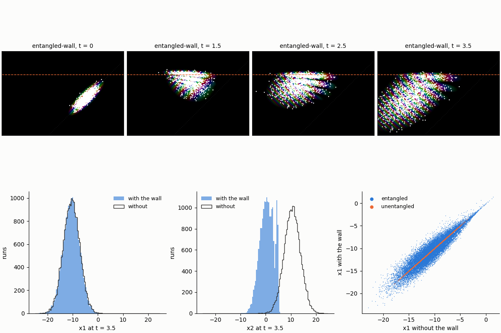

# pilot-wave

A deterministic pilot-wave (de Broglie-Bohm) simulation in two
dimensions, written from scratch in Rust with no dependencies. A
wavefunction on a square grid is stepped by the Schrödinger equation,
and particles with definite positions ride its phase gradient.
Positions drawn from |ψ|² at the start stay distributed as |ψ|², so an
ensemble of deterministic trajectories reproduces the quantum
statistics. Experiments are plain data: a stage, a source, a duration
and a list of expectations, each a named measure with an expected
value and a tolerance, checked after every run. See `GOAL.md` for
what this is working towards.


## Running it

```
cargo run --release -- list
cargo run --release -- describe single-slit
cargo run --release -- run single-slit [particles] [out]
cargo test --release
```

`describe` prints the experiment's summary, its physical realisation
with the unit conversions, the grid, and the expectations. `run`
prints the same, runs, and ends with a verdict per expectation; it
exits non-zero if any fails. It also writes frames
`<out>/<experiment>_NNNN.png` every half time unit (hue is the phase,
brightness the density), the trails of 300 particles over the
time-integrated density, the screen as a plot and a table, and the
arrivals in order. The figures come from

```
cargo run --release -- run single-slit 40000 out/single-slit
.venv/bin/python tools/figures.py single-slit
```

with a Python venv holding numpy and matplotlib at `.venv`.

## Units

The engine uses ħ = m = 1. A beam's wavelength is 1, so its
wavenumber and speed are both 2π and its kinetic energy 2π². Each
experiment names a physical realisation, a particle and the SI length
of one unit, for a beam its de Broglie wavelength λ, and the units
follow: time mλ²/ħ, speed ħ/(mλ), energy ħ²/(mλ²). For a 600 eV
electron (λ = 50 pm) one unit of length is 50 pm, of time
2.16·10⁻¹⁷ s, of speed 2.3·10⁶ m/s and of energy 30.5 eV; `describe`
prints these for every experiment.

## The model

Each step applies the Hamiltonian, a fourth order Laplacian plus the
potential, to the imaginary part to advance the real part, then the
reverse, in one fused sweep per band of rows on all cores
(`wave.rs`). Hard walls are cells kept at zero and an absorbing sponge
at the edges swallows what reaches it. The guiding velocity is the
probability current over the density, each interpolated between the
surrounding cells before dividing, with fourth order gradients, and
particles move in substeps of at most a quarter cell, so they turn
back from the near-nodes of standing waves instead of crossing them
(`particles.rs`). Positions are drawn from |ψ|² on the grid
(`sample.rs`). A screen bins each particle's first crossing of the
line and the time-integrated current through it (`screen.rs`).

The grid is either the plane one particle moves in, or the
configuration space (x₁, x₂) of two particles on a line: with unit
masses the Laplacian in (x₁, x₂) is both particles' kinetic energy, so
the solver steps it unchanged, and one sampled point is one run of the
two-particle experiment (`pair.rs`, `encounter.rs`). A spin direction
on the field adds Holland's term ∇×(ρ ŝ)/2ρ to the guiding velocity,
the de Broglie-Bohm velocity of the Pauli equation; it has no
divergence, so the density evolves as without it.

An experiment (`experiment.rs`) is a `Realisation`, a grid, walls as
rectangles (with `slits` and `band` to build them), a potential and a
source as plain functions of position and of the field, a spin, a
particle count, a duration, an optional screen with the closed form
to compare its current with, and expectations: named measures, each
with an expected value and a tolerance. The runner (`run.rs`) builds
the field, samples the particles, steps both, and measures; where a
measure compares against the twin, the experiment without its
potential, it runs the same starting points through that too.
`report.rs` prints and writes.

## Experiments

### Single slit

A packet 6 wide across and 2 long heads up at speed 2π towards a wall
0.4 thick with one slit 2 wavelengths wide; a screen 30 further on
counts what comes through. Every particle is an independent run of the
one-particle experiment, since all share the field and never interact,
so one run with 40000 particles is 40000 runs with one, and the
arrivals are recorded in order so the pattern can be watched building
up one particle at a time, as in the electron build-up films.

Realisation: a 600 eV electron, as in Bach et al. (2013), whose slit
was 62 nm, over a thousand wavelengths, so their pattern sits at angles
a thousand times smaller than ours; the shape, sinc² with a cos²
obliquity factor, is the same.

| expectation | expected | measured |
|---|---|---|
| fraction through the screen, the beam's share across the slit | 0.133 ± 0.010 | 0.1264 |
| probability through the screen, likewise | 0.133 ± 0.010 | 0.1271 |
| rms gap between the current and Fraunhofer, of the peak | 0 ± 0.03 | 0.0177 |
| rms gap between the arrivals and the current, of the peak | 0 ± 0.03 | 0.0257 |
| current at the first zero of sinc², x = 17.2, of the peak | 0 ± 0.02 | 0.0095 |

The arrived fraction sits 5% under the geometric share because the
slit's edges diffract some of the wave back; the current's first
minimum falls to 1% of the peak at the predicted place.

### Double slit

The same beam meets a wall with two slits 1 wide and 4 apart, centre
to centre: cos²(πd sinθ) fringes under the sinc²(πa sinθ) envelope,
orders at sinθ = m/4. Each particle goes through one slit or the
other and never crosses the axis of symmetry, yet the ensemble lands
on the fringes, which build up one particle at a time as in the
electron films. The realisation is again the 600 eV electron of Bach
et al. (2013), whose slits were 62 nm wide and 272 nm apart: d/a = 4.4
against our 4, so about as many fringes fit under the envelope, but
theirs are 0.18 mrad apart against our 0.25 rad.


| expectation | expected | measured |
|---|---|---|
| fraction through the screen, the beam's share across both slits | 0.126 ± 0.010 | 0.1184 |
| probability through the screen, likewise | 0.126 ± 0.010 | 0.1195 |
| rms gap between the current and Fraunhofer, of the peak | 0 ± 0.035 | 0.0282 |
| rms gap between the arrivals and the current, of the peak | 0 ± 0.03 | 0.0225 |
| x of the first-order maximum, d sinθ = 1 | 7.7 ± 0.8 | 7.6 |
| current at the first minimum, d sinθ = 1/2, of the peak | 0 ± 0.1 | 0.019 |

## Two particles on a line

Two particles on a line have one wavefunction ψ(x₁, x₂) on the same
square grid, and the Bohmian system is one point (x₁, x₂) moving with
the guiding velocity; each sampled point is one run. The frames show
configuration space, x₁ across and x₂ up, with the diagonal x₁ = x₂
dotted. An interaction is a potential U(x₁ − x₂), and the statistics
of identical particles come from the symmetry of the initial state
alone: ψ(x₁, x₂) = ±ψ(x₂, x₁) is preserved by the dynamics.

```
for e in distinguishable bosons fermions scattered molecule molecule-break; do
  cargo run --release -- run $e 20000 out/$e
done
.venv/bin/python tools/figures.py pairs scattered molecule
```

### Pauli exclusion from a node

Two packets 1 wide start at x = ∓4 and head for each other at
wavenumber ±2, as the product a(x₁)b(x₂) (`distinguishable`) or as
a(x₁)b(x₂) ± b(x₁)a(x₂) (`bosons`, `fermions`): one packet moving
towards the diagonal, or two mirrored across it. The antisymmetric ψ
vanishes on the whole diagonal, and that node is all there is to
Pauli exclusion here: no force acts, yet the guiding velocity turns
every run back before the particles meet. Bosons do not cross either,
since a symmetric ψ guides mirrored points in mirrored ways and the
diagonal is a trajectory of its own, but they reach it and bunch
there. The expected peaks of the probability of the particles being
within 0.5 of each other, at t ≈ 2, are the free spreading of the
relative motion in closed form: 0.197 for distinguishable particles,
0.287 for bosons, 0.109 for fermions.



| expectation | distinguishable | bosons | fermions |
|---|---|---|---|
| fraction of runs in which the particles pass each other | 1 ± 0.005: 0.999 | 0 ± 0.005: 0.0000 | 0 ± 0.005: 0.0001 |
| most of the runs ever within 0.5 (± 0.01) | 0.197: 0.199 | 0.287: 0.288 | 0.109: 0.114 |
| most probability ever within 0.5 (± 0.005) | 0.197: 0.195 | 0.287: 0.284 | 0.109: 0.109 |

The one fermion run in 20000 that crossed is numerical: the node lies
along the cells (i, i) themselves, and a substep that lands next to
them can step over.

### Entangled by meeting

`scattered` is the two distinguishable packets again with a Gaussian
bump of height 4.8 and range 0.4 between the particles, which at their
relative energy of 4 lets about half the wave through and reflects
the rest. Entangled by nothing but having met, the pair leaves in two
branches: passed, particle 1 on the right and particle 2 on the left,
or bounced, each back where it came from. Either way the particles
end on opposite sides of the origin, so a measurement of one, which
side it is found on, tells which side the other is on, however far
apart they are; and the mutual information of the joint density, zero
exactly for a product, stays at the entropy of the two branches, ln 2,
while they separate. In this theory the measurement reads a position
the particle already has, and the branch the pair is not in goes on
as an empty wave. No laboratory can do this as it stands: it needs two
particles in one dimension that interact only with each other, which
is why it is here, as the simplest entanglement there is. It runs on
a line twice as long, |x| ≤ 25.6, until t = 8, so that the slow tails
of both branches clear the origin.



| expectation | expected | measured |
|---|---|---|
| fraction of runs in which the particles pass each other, the field's transmission | 0.5 ± 0.03 | 0.489 |
| fraction of runs ending with the particles on opposite sides of the origin | 1 ± 0.005 | 0.996 |
| mutual information of x₁ and x₂ in the field at the end, ln 2 | 0.693 ± 0.05 | 0.692 |

The `distinguishable` control checks the other way: its mutual
information at the end is zero, a product state.

### A molecule

A Gaussian well U = −6 exp(−r²/0.32) in the separation binds exactly
one state of the relative motion, 2.8 deep. The pair starts as a
Gaussian in its centre and separation, relaxed in imaginary time into
that bound state, then gets total wavenumber k towards a hard wall at
x = 5 that only particle 1 feels, the half plane x₁ > 5. A wall both
felt would be a right-angled corner, which reflects the pair like a
corner reflector, reversing the centre's motion and mirroring the
relative motion, so it never breaks a molecule. With k = 2 (`molecule`,
kinetic energy 1, a third of the binding energy) particle 1 bounces
and drags particle 2 round with it. With k = 5 (`molecule-break`,
kinetic energy 6.25, 2.2 times the binding energy) particle 2 runs on
through where the wall is not, and most pairs break into a ring of
fragments around the bound part that still bounces back along the
diagonal; 0.15 stay bound.



| expectation | molecule | molecule-break |
|---|---|---|
| fraction of the runs more than 3 apart at the end | 0 ± 0.002: 0.0004 | 0.85 ± 0.03: 0.846 |
| probability apart at the end, counting what left the line | 0 ± 0.02: 0.0043 | 0.85 ± 0.03: 0.848 |

## Entanglement

Two particles are entangled when ψ(x₁, x₂) is not a product
a(x₁)b(x₂), and in Bohmian mechanics that has a direct meaning: the
velocity of particle 1 is read off ψ at the pair's configuration
(x₁, x₂), so for a product it depends on x₁ alone, and for an
entangled ψ on where particle 2 is, however far away. The pair starts
together and flies apart, particle 1 to the left: with the centre
c = (x₁ + x₂)/2 and the separation r = x₁ − x₂,

ψ ∝ exp(−c²/4σ_c² − r²/4σ_r²) e^{−ikr},  σ_c = 1, σ_r = 0.6, k = 3,

positions correlated and momenta anticorrelated. It runs on a line
|x| ≤ 25.6 in cells of 0.05 until t = 3.5, when the particles are 21
apart on average.

```
for e in entangled entangled-wall unentangled-wall; do
  cargo run --release -- run $e 20000 out/$e
done
.venv/bin/python tools/figures.py entangled
```

### The entanglement survives separation

For free flight the correlation of x₁ and x₂ has a closed form,
(Var c − Var r/4)/(Var c + Var r/4) with Var c = σ_c² + t²/16σ_c² and
Var r = σ_r² + t²/σ_r². It starts at 0.835, passes through zero at
t = 2σ_cσ_r = 1.2, when |ψ|² is momentarily exactly a product and the
entanglement sits wholly in the phase, in velocities that depend on
the other particle's position, and settles negative once the spread
of the separation outgrows that of the centre: a particle 1 that went
far left is matched by a particle 2 that went far right (`entangled`).

| expectation | expected | measured |
|---|---|---|
| correlation of x₁ and x₂ over the runs at t = 3.5, closed form | −0.659 ± 0.02 | −0.659 |
| correlation of x₁ and x₂ in the field, likewise | −0.659 ± 0.01 | −0.659 |

### Nonlocal guidance, no signalling

`entangled-wall` adds a wall only particle 2 feels, a steep ramp
V = 20 (x₂ − 5) for x₂ > 5, the half plane above the dashed line in
the frames. Particle 2 meets it at t ≈ 1.7, when particle 1 is about
10 away on the other side with nothing in its way. The runner runs the
same 20000 starting points again without the wall, the twin, and
compares run by run: each particle 1 ends somewhere else once particle
2 has bounced, yet the density of x₁ is the same with the wall and
without, so no observer of particle 1 alone can tell whether particle
2 met a wall. `unentangled-wall` is the control, the product of the
same two marginal packets: particle 1 goes the same way with the wall
and without, up to the time stepping, which keeps a product only
nearly a product.



| expectation | entangled-wall | unentangled-wall |
|---|---|---|
| median change of x₁ against the same run without the wall | 0.75 ± 0.15: 0.750 | 0 ± 0.01: 0.0036 |
| largest change of x₁'s density, of its peak: no signalling | 0 ± 0.001: 0.0001 | 0 ± 0.001: 0.0001 |
| largest change of x₂'s density, of its peak | 0.95 ± 0.1: 0.944 | 0.95 ± 0.1: 1.000 |

## Spin without a magnetic field

In the de Broglie-Bohm theory of the Pauli equation the spin is a
property of the pilot wave, a spinor, and the velocity carries one
more term than the spinless one: v = Im(ψ†∇ψ)/ψ†ψ + ∇×(ψ†σψ)/2ψ†ψ
(Holland 1993). For a spin eigenstate ψ†σψ = ρ ŝ with ŝ the spin
direction, so the term is ∇×(ρ ŝ)/2ρ; it has no divergence, so |ψ|²
evolves exactly as without it and every position statistic is
unchanged, yet the trajectories differ. For a particle moving in the
plane only the component of ŝ normal to the plane matters, giving
(∂ᵧρ, −∂ₓρ)/2ρ. Das and Dürr (2019, Sci. Rep. 9, 2242) showed that
this makes the arrival times of a spin-1/2 particle released from a
box into a waveguide depend on its spin, with no magnetic field
anywhere: with the spin across the guide the arrivals stop after a
maximum time, where the spinless distribution has a long tail. (Which
arrival-time distribution a real detector records is contested; see
Goldstein, Tumulka and Zanghì 2024 and the reply by Das et al.)

`spin-in-plane` and `spin-normal` are the plane version: a particle
in the ground state of a box 4 long at the closed end of a channel
along y, confined across it by ½ω²x² with ω = 4 (|ψ|² 0.35 wide), is
released at t = 0, and a line 40 further on records when each
particle first crosses it. With the spin in the plane the
trajectories are the spinless ones. With the spin normal to the plane
the term is a circulation along the contours of the density, and the
particles loop as they go: up the channel on one side of the axis and
down on the other, by ωx, and across it where the density changes
along the channel, so the slow tail behind the front is carried to
the fast side and the arrivals pinch off. The sponge beyond the line
takes the wave away, but the slow tail's long wavelengths partly
reflect from it, so the line sits 49 before the sponge; with it 6
before, a third fewer particles arrived.

```
cargo run --release -- run spin-in-plane 20000 out/spin-in-plane
cargo run --release -- run spin-normal 20000 out/spin-normal
.venv/bin/python tools/figures.py spin
```


| expectation | spin-in-plane | spin-normal |
|---|---|---|
| fraction of the particles arriving by t = 120 | 0.90 ± 0.01: 0.903 | 1 ± 0.01: 0.9993 |
| fraction arriving after t = 90 | 0.10 ± 0.01: 0.098 | 0 ± 0.01: 0.0000 |
| mean arrival time | 60.5 ± 1: 60.5 | 55 ± 1: 55.0 |

The realisation is the electron of Das and Dürr with a box 50 μm long,
one unit 12.5 μm, so the line is 0.5 mm down the guide and the unit
of time is 1.35 μs; the units `describe` prints. Their guide is a
cylinder and ours a strip, so the numbers differ, but the mechanism
and the pinch-off are the same.

## Further experiments worth setting up

Found while looking for experiments that fit this engine:

- Bohmian trajectories through a double slit were reconstructed from
  weak measurements of photon momentum by Kocsis et al. (2011,
  Science 332, 1170); the average trajectories match ours in form.
- A classical disc and barrier with their closed forms (the shadow's
  bright axis, the tunnelling probability) were done here before and
  can come back as definitions.
- The Aharonov-Bohm flux line, which shifts the double-slit fringes by
  half an order and gives the trap state half a unit of angular
  momentum, was done here before (the sign-flipping cut in the grid)
  and can come back as a definition once the cut returns.
- A numerical Bell experiment in de Broglie-Bohm theory (Dartois,
  Seidelin and Drezet, arXiv 2026) samples entangled positions and
  finds spin correlations that violate Bell's inequality while
  respecting no-signalling: with spin on the field, the next step
  after the entangled pair.
- Lattices of interacting particles need more than two particles, and
  configuration space grows a dimension per particle, so they want a
  mean-field or a chain of pairs rather than the full ψ.
