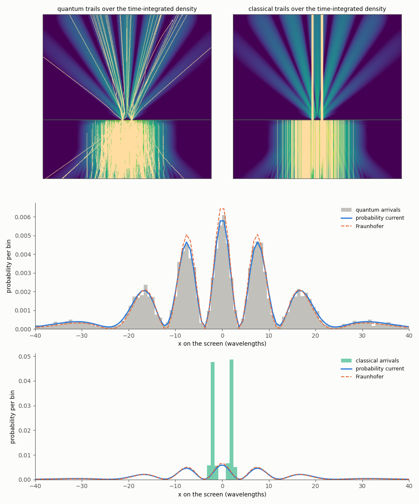
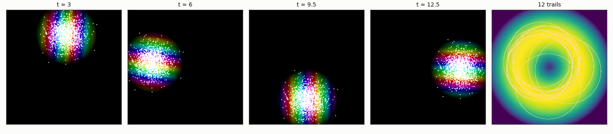
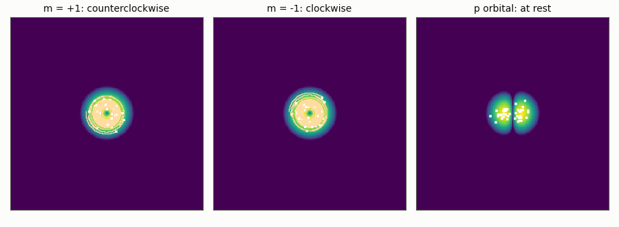
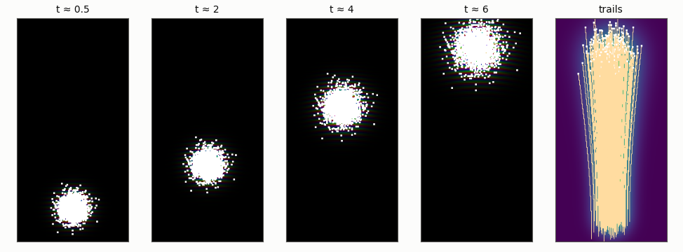
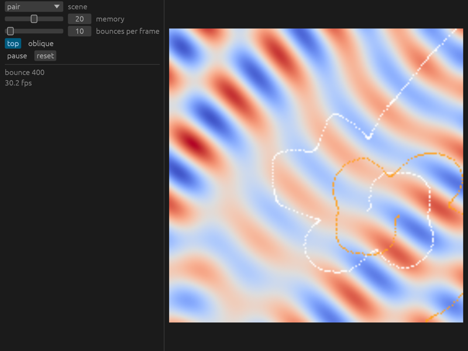
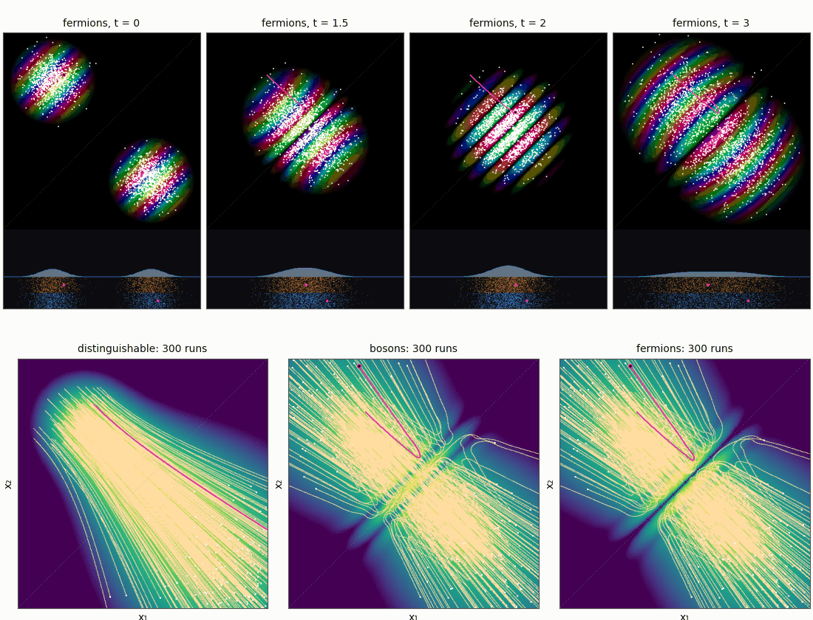
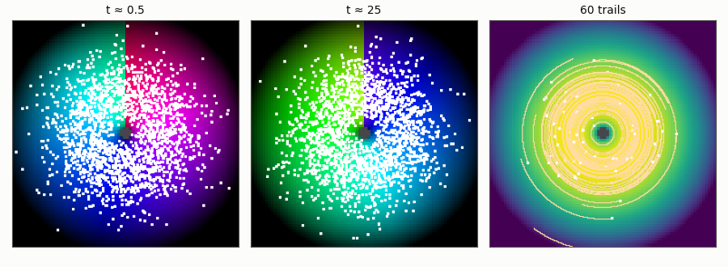
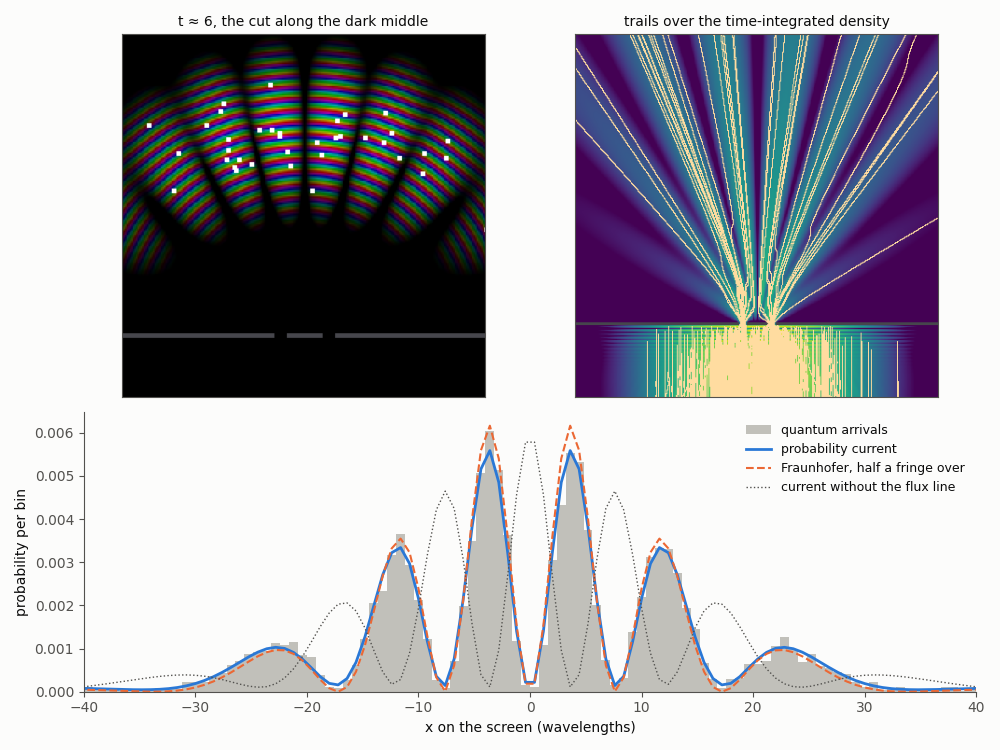

# pilot-wave

A de Broglie-Bohm pilot-wave simulation in two dimensions, written from
scratch in Rust. A wavefunction on a square grid is stepped by the
Schrödinger equation (units ħ = m = 1, wavelength 1, so the packet's
wavenumber and speed are both 2π), and particles with definite
positions ride its phase gradient. Positions drawn from |ψ|² at the
start stay distributed as |ψ|², so an ensemble of deterministic
trajectories reproduces the quantum statistics. In classical mode the
same particles obey Newton in the same potential instead, for
comparison. The only dependency is eframe, for the live viewer.



## Running it

```
cargo run --release -- <experiment> [particles] [out] [classical]
```

`experiment` is `free`, `double-slit`, `single-slit`, `barrier`, `disc`,
`harmonic`, `ground` or `box`; `particles` defaults to 2000 and `out` to
`out`. A run writes frames `<out>/<experiment>_NNNN.png` every half time
unit (hue is the phase, brightness the density), the trails of 300
particles over the time-integrated density in
`<out>/<experiment>_trajectories.png`, and its checks on stdout. The
experiments with a screen also write `<out>/<experiment>_screen.png`
and `.csv`: the particle arrivals (white), the time-integrated
probability current through the screen (blue) and the theory (orange),
arrivals and theory scaled to the current's total.

The figures below are made from runs into `out/<experiment>` (and
`out/<experiment>-classical`, `out/harmonic-few` with 12 particles,
`out/ground-few` with 60 and `out/barrier-few` with 300), each run's
stdout saved as `summary.txt` beside it:

```
mkdir -p out/double-slit
cargo run --release -- double-slit 60000 out/double-slit | tee out/double-slit/summary.txt
.venv/bin/python tools/figures.py
```

## Experiments

All runs share a 1024² grid of cells 0.1 wide (a domain 102.4 across,
ten cells per wavelength) with an absorbing sponge at the edges; the
traps and the box use a 256² grid of the same cells. The packet starts
at y = −20 heading up at speed 2π, walls sit at y = 0 and the screen at
y = 30. A run with a screen lasts until the packet's centre would be 25
past the screen, which lets 99.7% of the transmitted wave through it;
stopping as soon as the centre arrived missed a tenth of it. Every
screen run reports the fraction of particles that crossed the screen
against the probability that crossed it, which Bohmian mechanics says
agree.

### Double slit

Two slits 1 wide with centres 4 apart, in a wall 0.4 thick, lit by a
packet 6 wide (standard deviation of |ψ|² across) and 2 long. The
Fraunhofer curve is the two-slit cos² fringes under the single-slit
sinc² envelope, times cos²θ for a cylindrical wave meeting a flat
screen; with d/a = 4 there are orders at sin θ = m/4, at x = 0, ±7.7,
±17.2 and ±33.8.

With 60000 particles, 7066 (0.1178) reach the screen against 0.1195 of
the probability, and the rest reflect. The current follows the
Fraunhofer curve to 2.8% of the peak, rms, with its maxima at 0, ±7.6,
±16.4 and ±30.8 where the curve's are (the envelope pulls them in from
the grating angles). Summed over each order the current is within 10%
of the curve's in orders 0 to 2 and 28% above it in the faint third.
The arrivals match the current to 1.5% in every order up to the
second and to 7% in the faint third, 2.1% of the peak rms over the
whole screen; no single bin is off by more than 6%. Of 20000 classical
particles, 2545 (0.127, the beam's share over the two slits is 0.126)
arrive, every one within |x| < 3.

The figure at the top shows the quantum trails over the time-integrated
density, the classical trails, and the screens. The quantum arrivals
land on the fringes, fringe for fringe; the trails bend into the
bright fringes in the first few wavelengths past the wall and never
cross the axis of symmetry. The classical particles, all launched
straight up, go through the slits in straight lines and make two bands
the width of the slits at x = ±2, with nothing between or beyond.
Most particles of both kinds bounce off the wall.

Real electron double slits show the same pattern at much smaller
angles. Bach et al. (2013) used 600 eV electrons, wavelength 50 pm,
slits 62 nm wide and 272 nm apart: d/a = 4.4 against our 4, so the
envelope holds about the same number of fringes, but the fringes are
λ/d = 0.18 mrad apart against our 0.25 rad, because their slits are
over a thousand wavelengths wide where ours are one. Jönsson's first
electron double slit (1961) used 50 kV electrons, λ ≈ 5 pm, and slits
quoted as about 0.3 µm wide and 1 µm apart, fringes some 5 µrad apart.
The physics is the same cos² fringes under a sinc² envelope; ours are
simply spread over large angles because the slits are a few
wavelengths across, which is also why the cos²θ obliquity matters here
and not there.

### Single slit

One slit 2 wide, the same beam and screen. The envelope sinc²(πa sinθ)
has its first zeros at sin θ = λ/a = 1/2, x = ±17.2 on the screen,
dotted in the figure, and side lobes near x = ±30.


With 40000 particles, 5097 (0.1274) reach the screen against 0.1271
of the probability. The current follows the Fraunhofer curve to 1.8% of
the peak, rms over the screen, with its minimum at x = 18.0 against
17.2 (one bin of 0.8) where it falls to 0.7% of the peak, and side
lobes within 4% of the curve's. The arrivals match the central lobe to
0.3% and the side lobes to 4%.

### Barrier

A potential step 0.4 wide (four cells) and 1.2 times the packet's
energy high across the whole domain at y = 0, with a packet 4 wide and
2 long. The rectangular-barrier transmission at k = 2π is
T = 1/(1 + V² sinh²(κa) / (4E(V − E))) with κ = √(2(V − E)); averaged
over the packet's Gaussian spread of wavenumber, standard deviation
1/(2σ_y) = 0.25, it rises slightly because the faster part tunnels more
easily.


The analytic transmission is 0.2268 at k = 2π and 0.2301 averaged
over the packet. The field agrees: 0.2199 of the probability crosses
the screen, 4% below the average, the grid's slightly heavier
effective mass along the motion accounting for most of the gap. The
particles agree with the field: 873 of 4000, 0.2182, get through.

The figure shows the packet splitting and, on the right, where the
transmitted particles started. In one dimension Bohmian trajectories
cannot cross, and this barrier is uniform in x, so the particles that
get through are exactly the ones that started at the front of the
packet. Which particle tunnels is decided by where it starts, not by
any chance at the barrier: every transmitted particle started at
y ≥ −18.432 and every reflected one at y ≤ −18.435, and the field's
transmission puts the split at −18.46. Getting this right needed the
velocity estimate described under Numerics: in front of the barrier
the incident and reflected waves (|r| = 0.88) make a standing wave
whose near-nodes are a fifth of a cell wide, and a velocity
interpolated between cells let particles cross them, 0.389 of them
getting through.

### Disc

A hard disc of radius 4 in a beam 8 wide. In two dimensions the disc
is a strip in cross-section, so its Poisson-Arago spot is a line along
the axis behind it. The orange curve is the Fresnel (Kirchhoff)
diffraction of the Gaussian beam with the disc's diameter blocked,
carried paraxially to the screen; the Fresnel number there is
R²/(λL) = 0.53, so the shadow is partly filled.


The field shows the spot: behind the disc the time-integrated density
has a dark wedge with a faint bright line down its middle, and on the
screen the current on the axis is 2.7 times that 1.2 to either side
(Kirchhoff predicts 3.3 times). The current follows the Fresnel curve
to 5% of the peak, rms, edge fringes in the lit region included;
Kirchhoff puts 7.9% of the screen's probability inside the geometric
shadow |x| < 4 where the field puts 4.0%, which is about what to expect
of Kirchhoff's boundary conditions on an obstacle only eight
wavelengths across.

Quantum particles fill the shadow as the current does: 13095 of 20000
(0.6548) reach the screen against 0.6559 of the probability, 3.9% of
the arrivals land inside |x| < 4 against 4.0% of the current, and the
four bins around the axis get 86% of the particles the current puts
there. The classical particles cast a sharp shadow: 12222 (0.611; the
Gaussian beam has 0.617 outside |x| < 4) reach the screen, none inside
|x| < 4.

### Harmonic trap and ground state

A trap V = ω²r²/2 with ω = 0.5, period 4π. The coherent state is the
ground-state Gaussian (width 1/√(2ω) = 1) displaced to (4, 0) and given
momentum ω·4 upward, so it orbits on a circle of radius 4 without
changing shape. Its phase is linear in position, so every particle
moves with the packet's centre: each one traces its own circle of
radius 4 around its starting offset from the centre. The figure shows
the packet at quarter periods and twelve trails over two periods.



Over two periods the packet's width stays 1.0000 along both axes.
The worst of 300 trails strays 0.066 from its circle of radius 4, and
after the two periods the particle that ends farthest from its start
is 0.068 away, out of an orbit 50 long: a lag of 0.14%.

The ground state has a real wavefunction up to a global phase, so its
phase gradient is zero everywhere: Bohmian particles in a stationary
state sit still, even though the quantum "motion" in the state is
there in the momentum distribution. The figure shows the density at
the start and after two periods and sixty particles that never move.


Over two periods (t = 25, 14000 steps) no particle of 2000 moves more
than 4.7·10⁻⁶, and the density changes by at most 2.5·10⁻⁶ of its
peak.

### Vortex states: an orbital spin

The trap's first excited level holds the states ψ ∝ (x ± iy) e^{−ωr²/2},
with angular momentum m = ±1. Their density is a stationary ring, but
their phase winds once around the centre, so every particle circles
it at speed 1/r, counterclockwise for m = +1 and clockwise for m = −1:
a stationary state whose particles never stop moving, and a classical
picture of what the quantum number m means. The sum of the two is the
real p orbital x e^{−ωr²/2}, whose particles stand still. The runner
reports the mean r × v of the particles, the orbital angular momentum
each one carries about the centre.



Over two periods the `vortex` and `antivortex` runs give angular
momentum +1.0004 and −1.0004 per particle, the density changing by at
most 4.3·10⁻⁶ of its peak while every particle goes around; the
`orbital` run gives 0.0000 and no particle moves more than 2·10⁻⁶.

### Box and free packet

A packet 1 wide launched at (π, π/2) in a box with hard walls at ±6,
with no sponge. It reflects off the right wall and then the top, and
the standing waves near the walls gather the particles into stripes
parallel to them.


The norm ends at 0.9990 after t = 6 with nothing absorbing it. 0.8%
of the particles end beside a wall, where 0.43% of the probability is.

A free packet 1.5 wide crosses the domain and spreads as
σ(t) = σ₀√(1 + (t/2σ₀²)²); each Bohmian particle keeps its place in the
packet, its offset from the centre growing as x(t) = x₀σ(t)/σ₀, so
the trails fan out in straight lines.



After t = 6 the packet is 2.5003 wide across, against 2.5000 expected,
and 2.4621 along its motion. The difference along y is the grid: at
k·dx = 0.63 the fourth-order Laplacian's dispersion has curvature
0.976 instead of 1, an effective mass 2.5% heavier along the motion,
which predicts 2.4613.

### Numerics

The guiding velocity is the probability current over the density,
each interpolated between the four surrounding cells before dividing,
with fourth order differences for the gradient so a plane wave at ten
cells per wavelength comes out within 0.3%. Interpolating a velocity
computed per cell instead, or the phase difference between
neighbouring cells, smooths over the near-nodes of standing waves,
where the density dips to nearly zero within a fraction of a cell and
the velocity must soar to turn the particle back; particles then cross
them, and the barrier's particle transmission came out 0.389 against
the field's 0.220. Particles move in substeps of at most a quarter
cell for the same reason. Where the wave meets a wall ψ is zero and so
is the velocity. What remains is the grid's dispersion: at k·dx = 0.63
the Laplacian's curvature is 0.976 instead of 1, an effective mass
2.5% heavier along the motion, which the free packet and the barrier
both show. Halving the cells would quarter that.

## Live viewer

```
cargo run --release --bin live
```

The side panel picks the experiment, the particle count, quantum or
classical particles, the grid size (256, 512 or 1024), the replay
speed in time units per second, and the view: phase (hue) with
density (brightness), density alone, or the density as a lit surface.
Under the field, experiments with a screen plot the arrivals, the
integrated current and the theory as they build up. `live --screenshot
images/live.png` runs for two seconds, saves the window and quits.



## Two particles in one dimension

Two particles on a line have one wavefunction ψ(x₁, x₂), which lives on
the same square grid as before: with unit masses the Laplacian in
(x₁, x₂) is the kinetic energy of both particles, so the solver steps
it unchanged. The Bohmian system is one point (x₁, x₂) in this
configuration space moving with the guiding velocity; its two
coordinates are the two particles' positions on the line. Each sampled
point is one run of the experiment, drawn from |ψ|² on the grid, and
the ensemble gives the statistics. An interaction is a potential
U(x₁ − x₂) across the plane, a trap would be V(x₁) + V(x₂), and the
statistics of the particles are set by the initial state alone:
symmetric under x₁ ↔ x₂ for bosons, antisymmetric for fermions,
neither for distinguishable particles.

```
mkdir -p out/fermions
cargo run --release -- fermions 2000 out/fermions | tee out/fermions/summary.txt
```

The experiments are `fermions`, `bosons`, `distinguishable`,
`molecule` and `molecule-break`, all on a 256² grid of cells 0.1 wide
(the line |x| ≤ 12.8, whatever grid is asked for) with the sponge at
the ends. A frame shows configuration space, x₁ across and x₂ up, with
the diagonal x₁ = x₂ dotted, and under it the line itself: the two
marginal densities as bands, x₁ of every run as a row of orange dots
and x₂ as a row of blue ones, and in pink the first run, the one to
follow. For identical particles the two marginals coincide, since the
labels carry no meaning. The runs report the fraction of runs that
ever crossed the diagonal, the closest the two particles came, and the
most probability ever found within 0.5 of the diagonal against the
most runs; the molecules report their separation over time. The
figures use runs of 2000 into `out/<experiment>` and runs of 20000
into `out/molecule-many` and `out/molecule-break-many`.

### Pauli exclusion from a node

Two packets 1 wide start at x = ∓4 and head for each other at k = ±2,
free, as the product a(x₁)b(x₂) (distinguishable), or as
a(x₁)b(x₂) ± b(x₁)a(x₂) (bosons and fermions). In configuration space
that is one packet, or two mirrored across the diagonal, moving
towards it. The antisymmetric ψ vanishes on the whole diagonal, and
that node is all there is to Pauli exclusion here: no force acts,
yet the probability of finding the fermions together is zero and the
guiding velocity turns every run back before it gets there.



The top row shows the fermions: the two mirrored packets meet at the
diagonal at t ≈ 2 in fringes parallel to it, with a dark node along
it, and leave again. Below are 300 trails of each kind over the
time-integrated density. Distinguishable particles pass straight
through each other: 0.999 of the runs cross the diagonal, the rest
being the slowest tail of the packet still on its way at t = 5.
Fermion runs bounce off the diagonal: none of 2000 crosses, the
closest approach is 0.013 and half the runs never come within 1.10.
Boson runs do not cross either, since a symmetric ψ guides mirrored
points in mirrored ways and the diagonal is a trajectory of its own,
but they reach it, the density being largest there: the closest
approach is 0.0003. Their median closest approach is 1.44, further
than the fermions', because the interference fringes beside the
diagonal (nodes at |x₁ − x₂| = π/4, 3π/4, …) turn most runs back
before they get to the bright one in the middle.

The probability of the particles being within 0.5 of each other peaks
at t ≈ 1.9 at 0.108 for fermions, 0.195 for distinguishable particles
and 0.284 for bosons: antibunching and bunching, 0.56 and 1.46 times
the distinguishable value. Free propagation of the relative motion in
closed form gives 0.109, 0.197 and 0.287. The runs agree with the
field: of 20000, 0.114, 0.200 and 0.288 at their peaks.

Of 20000 fermion runs, two crossed the diagonal, and the closest
approach was 4·10⁻⁶. That is numerical. The node lies along
the cells (i, i) themselves, and the velocity, interpolated between
four cells two of which sit on the node, has a gradient across the
diagonal that grows without bound towards those cells; a substep that
lands there can step over.

### A molecule

An attractive well U = −U₀ exp(−(x₁−x₂)²/(2w²)) with U₀ = 6 and
w = 0.4 binds exactly one state of the relative motion (reduced mass
1/2), 2.82 deep; a second one would need a well about 9 deep. The
molecule starts as a Gaussian in its centre (width 1) and in its
separation, relaxed for an imaginary time of 4 by ψ ← ψ − dτ H ψ with
renormalisation, which leaves the relative motion in its bound state
(energy −2.79, the rest being the centre's spread) and the centre a
Gaussian 1.4 wide. Multiplying by e^{ik(x₁+x₂)/2} then gives the pair
total momentum k, kinetic energy k²/4, and sends it along the diagonal
towards a hard wall at x = 5.

The wall is one only particle 1 feels. A wall both particles feel is
a right-angled corner in configuration space, x₁ < 5 and x₂ < 5, and a
corner reflects the way a corner reflector does: it reverses the
centre's motion and mirrors the relative motion, x₁ − x₂ → x₂ − x₁,
leaving the bound state as it was. With such a wall kicks of k = 5
and 6 left 0.0003 and 0.0011 of the probability apart. With the wall on
particle 1 alone, particle 1 bounces while particle 2 keeps going, and
the relative motion takes up the pair's kinetic energy k²/4.


With k = 2 (k²/4 = 1.0, a third of the binding energy) the pair
bounces as a pair. On its way in and out the wave makes a standing
wave of the centre against the wall, which shows as blobs along the
diagonal, while the separation stays put: over 20000 runs it is
0.393 ± 0.335 at the start, dips to 0.388 ± 0.331 during the bounce
and is 0.397 ± 0.345 at t = 15. At the end 0.0004 of the runs are more
than 3 apart, against 0.0001 of the probability.

With k = 5 (k²/4 = 6.25, 2.2 times the binding energy) the bond breaks:
particle 1 turns at the wall, particle 2 runs through it, and the
outgoing part of the wave is a ring of dissociated pairs around the
bound part that still bounces back along the diagonal. The separation
climbs from 0.39 to 9.4 ± 5.2 by t = 6. Of 20000 runs, 0.846 end more
than 3 apart; in the field 0.649 of the probability is apart and the
sponge has taken 0.199, all of it fragments flying off, 0.848 in all.
The remaining 0.15 stays bound even though the kick carried more than
twice the binding energy.
## Flux line

A thin solenoid carries magnetic flux Φ but no field outside it, yet a
charge going around it picks up the Aharonov-Bohm phase 2πΦ/Φ₀. In the
gauge where the vector potential vanishes everywhere except on a cut, a
half line from the flux point to the edge of the domain, ψ is
continuous everywhere but jumps by that phase across the cut. For half
a flux quantum the jump is a sign, which the real and imaginary parts
carry exactly: every reach of the Laplacian stencil across the cut
reads its neighbour with the sign flipped. Here the cut runs straight
up from the flux point between two columns of cells (`Wave::flux_line`
puts the flux point at the nearest cell corner). The fused row update
is left as it is and the four cells beside the cut get a correction
afterwards, and the guiding current's x gradient is corrected the same
way; vertical reaches never cross the cut. A cut through the whole
grid is a pure change of gauge, and the tests check that stepping with
it is the same as flipping the sign of everything right of it,
stepping without it and flipping back. Only half a flux quantum is
done; other fluxes would need a complex phase on the reaches.

Phase pictures show a seam along the cut, where the hue jumps by half
the colour wheel. That is the gauge, not physics: the density, the
current and the trails are all continuous across it.

```
cargo run --release -- flux-trap 2000 out/flux-trap
cargo run --release -- flux-slit 60000 out/flux-slit
.venv/bin/python tools/figures.py flux-trap flux-slit
```

The figures also use `out/flux-trap-few` (60 particles),
`out/flux-slit-few` (300) and `out/double-slit` for the current
without the flux line.

### Trap

The harmonic trap of ω = 0.5 with the flux line at its centre, inside
a hard core of radius 0.2 that keeps the wave off the singular point,
as real solenoids are shielded. Going once around the flux line ψ must
change sign, so in ψ = f(r) e^{imθ} the angular momentum m is a
half-integer, and the levels are E = ω(2n + |m| + 1). The lowest are
m = ±1/2 at E = 3ω/2 = 0.75, a degenerate pair, with
f = √r e^{−ωr²/2}: near the centre the radial part goes as r^|m|.

Which state is stationary? The ground Gaussian times e^{iθ/2}, with θ
counted from the cut so that the half angle jumps exactly where ψ must,
has the right angular part but the radial part of m = 0. It is a mixture
of the radial levels n = 0, 1, 2, … of m = 1/2 and breathes: run as it
is, its density changes by up to 98% of its peak within two periods. The
state √r e^{−ωr²/2} e^{iθ/2} is stationary without the core, but the
core holds ψ at zero out to r = 0.2, where that state still has 40% of
its peak density, and it rings by up to 41%. So the experiment relaxes
the Gaussian times e^{iθ/2} in imaginary time for 10 time units
(`Wave::relax`) before it starts. Every level decays by its energy, and
as the trap, the core and the grid are all symmetric under quarter
turns, the start's m = 1/2 cannot leak into m = −1/2: what is left is
the lowest m = 1/2 state of this grid with this core. Its energy is
0.818, the 0.75 of half-integer m plus 0.07 for the core (0.744 with no
core at all, 0.872 with a core of radius 0.3).



With 2000 particles the mean angular momentum r × v is 0.5000 per
particle, against 0.0000 for the ground state and 1.0001 for the
vortex. Each particle carries exactly a half: the phase is θ/2, so
v = θ̂/2r and every particle circles the core at the angular speed
1/2r², the inner ones many times over the two periods and the outer
ones part of the way, all on circles. The conjugate state e^{−iθ/2}
is this run's mirror image, with −1/2. Over the two periods the
density changes by 8.4·10⁻⁶ of its peak, and the energy is 0.8179
against 0.5000 for the ground state and 1.0000 for the vortex.

That steadiness is read with im brought back half a step to re's time
(`Wave::centred_densities`). The scheme keeps im half a step ahead,
and re² + im² of a stationary state wobbles at twice its energy by a
relative E·dt, 1.5·10⁻³ here. The ground state and the vortex, with
E = 0.5 and 1, end their two periods, t = 8π, on a zero of that
wobble, which is why reading the density plainly looked steady for
them; mid-run it strays by 4.6·10⁻⁴ and 1.8·10⁻³ of the peak.

The half-integer angular momentum is the half-spin reading of the
flux line. A charge bound to a flux line has its angular momentum
shifted by the flux in units of the flux quantum, so around half a
quantum it takes half-integer values: Wilczek (1982) read such
charge-flux composites as particles of fractional spin, the start of
anyons, whose spin other fluxes set anywhere in between.

### Double slit around a flux line

The double slit with the flux line midway between the slits, at the
middle of the wall between them, so the wall shields it, and the cut
running up from there past the screen to the edge. The waves from the
two slits pass the flux line on opposite sides and meet with an extra
relative phase of π, so the fringes move by half a period: the middle
of the screen, the brightest place without the flux line, goes dark.
The theory is the Fraunhofer curve with the two slits' amplitudes
subtracted instead of added, sin² fringes under the same envelope. The
cut lies along the dark middle, so no seam shows here.



With 60000 particles, 7030 (0.1172) reach the screen against 0.1182
of the probability. The current has its maxima at d sinθ = ±0.49,
±1.46 and ±2.42 where the shifted curve has them at ±0.48, ±1.45 and
±2.40; the double slit without the flux line has them at 0, ±0.98,
±1.94 and ±2.87, so every fringe has moved to midway between two of
the old ones, half a period over to within 0.01 of an order. The two
bins at the middle of the screen get 3.9% of the peak current (the
theory puts 3.0% in bins 0.8 wide either side of its zero) and 2.1% of
the peak arrivals. The current follows the shifted curve to 2.8% of
the peak, rms, the same as the double slit follows its own; summed
over each fringe the arrivals match the current to 4.4% in the four
brightest and 9% in the faint outer pair, 2.2% of the peak rms over
the whole screen. No trail crosses the dark middle: the arrangement is
symmetric, so the current along it has no sideways part.

This is the Aharonov-Bohm effect (1959), with the particles never
touching a field. Chambers (1960) first saw it, with a magnetised iron
whisker between the two beams of an electron biprism shifting the
fringes. Tonomura et al. (1986) closed the loophole of leaking field
with a toroidal magnet covered in a superconductor, which shields the
field and quantises the flux through it in units of h/2e, half a flux
quantum for the electron: the fringes inside and outside the torus
were shifted by either nothing or exactly half a period, as here.

## Entanglement

Two particles are entangled when their wavefunction ψ(x₁, x₂) is not a
product a(x₁)b(x₂). In Bohmian mechanics that has a direct meaning:
the velocity of particle 1 is ∂₁ arg ψ evaluated at the pair's
configuration (x₁, x₂), so for a product it depends on x₁ alone, and
for an entangled ψ it depends on where particle 2 is, however far
away. These experiments let a pair fly apart, measure how correlated
the two positions stay, and then put a wall in particle 2's way to
see what that does to particle 1.

```
mkdir -p out/entangled out/unentangled out/entangled-wall out/unentangled-wall out/entangled-wall-few
cargo run --release -- entangled 20000 out/entangled | tee out/entangled/summary.txt
cargo run --release -- unentangled 20000 out/unentangled | tee out/unentangled/summary.txt
cargo run --release -- entangled-wall 20000 out/entangled-wall | tee out/entangled-wall/summary.txt
cargo run --release -- unentangled-wall 20000 out/unentangled-wall | tee out/unentangled-wall/summary.txt
cargo run --release -- entangled-wall 2000 out/entangled-wall-few
.venv/bin/python tools/figures.py entangled
```

The pair starts together and flies apart, particle 1 to the left:
with the centre c = (x₁ + x₂)/2 and the separation r = x₁ − x₂,

ψ ∝ exp(−c²/4σ_c² − r²/4σ_r²) e^{−ikr},  σ_c = 1, σ_r = 0.6, k = 3,

so |ψ|² is a Gaussian 3.3 times longer along the diagonal than across
it, and each particle moves at 3 away from the other. The positions
are correlated (the particles are close to each other wherever the
pair is) and the momenta anticorrelated (the total momentum p₁ + p₂
spreads 1/(2σ_c) = 0.5, the relative momentum (p₁ − p₂)/2 spreads
1/(2σ_r) = 0.83). The control, `unentangled`, is
the product of the same state's two marginal packets, each 1.04 wide
with its own wavenumber ∓3: the same x₁ and x₂ distributions at the
start, no correlation. They run on a line twice as long as the other
two-particle experiments, |x| ≤ 25.6, on a 1024² grid of cells 0.05
(why under the wall, below), until t = 3.5, when the particles are
21 apart on average, each spread 3.2 wide; a wall run of 20000, which
also runs its twin, takes about a minute and a half. Each
run reports, once a time unit, the correlation coefficient of x₁ and
x₂ over the runs and in the field, and the mutual information of
their joint distribution binned in squares 0.4 wide: the
Kullback-Leibler divergence of the joint from the product of its
marginals, zero exactly when the joint is a product.


### The entanglement survives separation

For free flight the two coordinates' correlation has a closed form,
(Var c − Var r/4)/(Var c + Var r/4) with Var c = σ_c² + t²/16σ_c² and
Var r = σ_r² + t²/σ_r², and both field and runs follow it (bottom
right in the figure):

| t   | runs    | field   | closed form | mutual information, field |
|-----|---------|---------|-------------|---------------------------|
| 0   | 0.835   | 0.835   | 0.835       | 0.570 nats                |
| 1   | 0.152   | 0.151   | 0.151       | 0.011                     |
| 2   | −0.392  | −0.393  | −0.393      | 0.083                     |
| 3   | −0.604  | −0.605  | −0.605      | 0.226                     |
| 3.5 | −0.659  | −0.659  | −0.659      | 0.284                     |

The correlation changes sign. At the start it is the position
correlation, the particles close together; as they fly apart the
spread of their separation, driven by the relative momentum, outgrows
that of their centre, and the momentum anticorrelation takes over:
a particle 1 that went far left is matched by a particle 2 that went
far right. In between, at t = 2σ_cσ_r = 1.2, the correlation passes
through zero, and since the density stays Gaussian, |ψ|² is at that
moment exactly a product: the entanglement is then wholly in the
phase of ψ, in velocities that depend on the other particle's
position. Once the pair is far apart it is in the density again: at
t = 3.5, 21 apart, the joint density is plainly not a product, with
a correlation of −0.659 and mutual information 0.284 nats in the field
(−½ ln(1 − ρ²) = 0.285 for a Gaussian). The unentangled control
stays a product throughout: correlation 0.0000 and mutual information
0.0000 in the field, and over 20000 runs 0.005 and 0.026 nats, which is
what sampling alone gives (the binned mutual information of 20000
runs is biased upwards by about the number of occupied bins over
twice the number of runs; the entangled runs give 0.333).

### Nonlocal guidance, no signalling

`entangled-wall` adds a wall that only particle 2 feels, at x₂ = 5,
a steep ramp V = 20 (x₂ − 5) for x₂ > 5; in configuration space it
fills everything above a horizontal line (dashed in the frames).
Particle 2 meets it at about t = 1.7, when particle 1 is about 10 away
on the other side with nothing in its way. The runner then runs the
same 20000 starting points again, stepping the experiment with the
wall and its twin without it side by side, and compares them run by
run. `unentangled-wall` does the same for the control.

Each run's x₁ changes. With the wall and without, the same run's
particle 1 is in different places once particle 2 has bounced:

| t   | largest change of x₁ | median |
|-----|----------------------|--------|
| 1   | 0.35                 | 0.0002 |
| 2   | 2.00                 | 0.11   |
| 3   | 4.05                 | 0.53   |
| 3.5 | 5.19                 | 0.75   |

The bottom left of the figure shows eight such runs: where particle 2
(blue) bounces, particle 1 (orange) leaves its path without the wall
(dashed). Particle 2 lingers at the wall: as in one dimension, the
particles at the front of the incoming packet turn first and become
the back of the outgoing one, so fast runs come back slow, and since
the momenta are anticorrelated their particle 1 slows down too. For
the unentangled pair the same comparison gives a largest change of
0.017 and a median of 0.004, three hundred times less; it would be
zero but for the time stepping, which keeps a product only nearly a
product (on a small test grid, particle 1's velocity at a fixed x₁
varies by up to 0.09 across particle 2's tail after t = 0.2, against
0.001 at the start).

Yet nothing about particle 1 that could be observed changes: no
signalling. At t = 3.5 the density of x₁ with and without the wall
differs by at most 1.3·10⁻⁴ of its peak, while that of x₂ differs by
0.94 of its peak. The runs agree as well: in bins of 0.4, the largest
difference between the two histograms of x₁ is 0.0036 of the runs,
against a statistical error of 0.0020 in that bin, and χ² between
them is 46.6 over 62 bins; for x₂ the largest difference is 0.055, χ²
36570 over 82 bins. For the control the x₁ densities differ by
3.5·10⁻⁵ of the peak, and the histograms by 0.0018 against an error
of 0.0028, χ² 2.6 over 38 bins (the runs barely move, so the two
histograms are nearly the same sample). In each run the runs follow
the field: χ² of the runs' x₁ against the field's density is 65.5
over 52 bins with the wall and 47.1 without, for x₂ 34.4 over 34 and
25.6 over 52. The wall rearranges which particle 1 ends where; it
cannot change how many end anywhere, so no observer of particle 1
alone can tell whether particle 2 met a wall. The x₁ density the
runner reports is R² + I², with the imaginary part half a step
ahead; the scheme's conserved R² + I₋I₊ gives the same x₁ density with
and without the wall to 5·10⁻⁵ of its peak, float precision, in the
test of the same setup on a small grid.

The wall and the grid were chosen with care. A wall of cells held at
zero, as elsewhere, let a few runs step into it: the interpolated
velocity stays finite up to such cells and is zero inside them, so
those runs froze, particle 1 included; in a trial run one ended 16
from its twin. A step 100 high made ψ fall off within a cell, and the
runs off it bunched. The ramp turns particle 2 back within half a
unit. And where particle 2 turns, the wave coming back interferes
with the wave still coming in, in fringes 0.5 to 1 apart; on cells of
0.1 the runs that went through them bunched in x₁ where the field did
not, χ² of the runs' x₁ against the field's density 112 over 56 bins
at the end, and the two histograms of x₁ differed by 2.6 times the
statistical error in one bin, χ² 82.7 over 65. On cells of 0.05 that
is gone, and each run's change of x₁ is the same as before to 2%.
