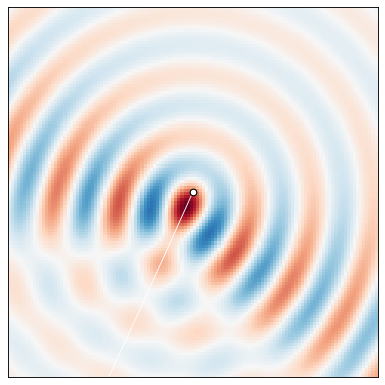
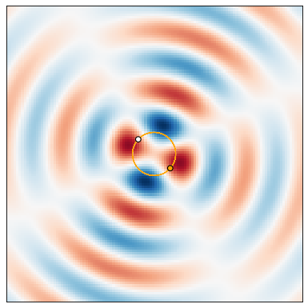
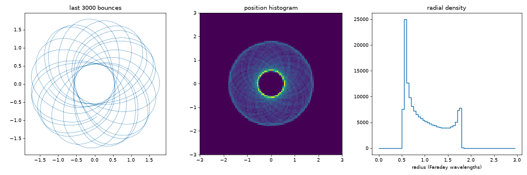
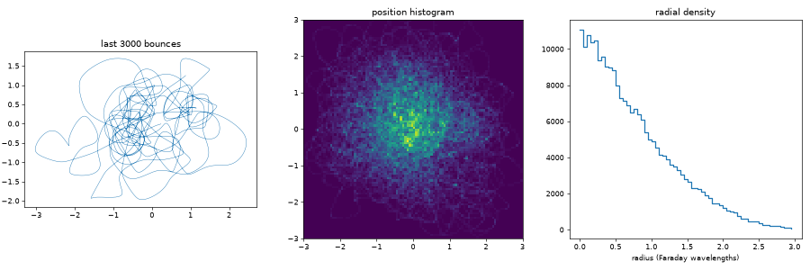

# pilot-wave

A minimal simulation of walking droplets (pilot-wave hydrodynamics),
built on NumPy and matplotlib. It is a stroboscopic path-memory model:
every bounce leaves a decaying standing wave, the droplet slides down
the slope of the sum of all past waves, and a memory parameter sets how
long the bath remembers. Physical accuracy is not the goal; the
qualitative quantum-like behaviour is.



## Running it

```
python3 -m venv .venv
.venv/bin/pip install -r requirements.txt
.venv/bin/python single.py 20       # one droplet, memory 20
.venv/bin/python pair.py 8 0.7      # two droplets, memory 8, 0.7 apart
.venv/bin/python trap.py 50 100000  # harmonic trap, 100k bounces
.venv/bin/python -m pytest
```

`single.py` and `pair.py` open a live view of the wave field, with the
droplets and their trails drawn on top. The colormap is rescaled every
frame, so the pattern stays visible while the memory fills up. `trap.py`
runs headless and then shows the last stretch of trajectory, the
two-dimensional position histogram and the radial density.

## The model

Lengths are in Faraday wavelengths and time is in bounces. The wave
left by an impact at `x_n` is `J0(k |x - x_n|)` with `k = 2π`, and it
decays by `exp(-1/memory)` per bounce. Each bounce the droplet feels
the slope of the summed field, loses a fixed fraction of its momentum
and steps by its velocity. That is all of `pilot_wave.py`; `bessel.py`
holds J0 and J1 so there is no SciPy dependency, and `render.py` holds
the matplotlib views.

The bouncer at rest sits on top of its own wave hill. The hill grows
with memory, and past `memory ≈ 5` (for the force and drag in the file)
the slightest noise tips the droplet over and it walks at a steady
speed of about 0.04 wavelengths per bounce. Below that it stays put.
Walking sets in once `k**2 * FORCE * memory**2 > 2 * DRAG`.

## What to look for

**Pairs.** Two droplets started 0.7 wavelengths apart with a small
tangential nudge lock into orbit at a separation of 0.73 wavelengths
at memory 8. Started 1.6 apart they orbit at 1.69. Experiments find
orbit diameters near `(n - 0.2)` wavelengths, so the quantization is
qualitatively right. Started from rest instead they bind as a static
pair at 0.58 wavelengths. At memory 20 and above the orbits break up
and the droplets scatter, as they do in experiments.



**Trap.** `trap.py` adds a spring force towards the origin. At memory
20 the droplet settles on a precessing orbit whose radius is set by the
wave field rather than by the spring alone: the histogram is an annulus
with sharp edges. At memory 50 and above the motion turns chaotic,
built from pieces of small circles and lemniscates, and the long-time
position histogram is a featureless blob. The quantization is in the
orbits, not in the position density.




## Next steps

The eigenstate-like position histograms of the corral experiments come
from waves reflecting off the boundary, so the confinement has to live
in the wave field, not in a force on the droplet. A square box with
mirror images of every impact across the walls was tried and does not
work as is: a droplet 0.3 wavelengths from a wall sits in the trough of
its own reflected wave, so it binds to the wall just as two droplets at
rest bind to each other, and it ends up pinned in the corners. Partial
reflection and a hard bounce at the wall reduce but do not cure this.
Two ways forward:

- A soft boundary, as in the experiments, where the wave is damped in a
  submerged rim rather than reflected by a hard wall.
- A modal cavity: expand the field in the box's or disc's standing
  modes near the Faraday wavenumber, so each bounce just adds to a few
  mode amplitudes. That is cheaper than images and is the model that
  has reproduced quantum-like statistics in a circular cavity.
